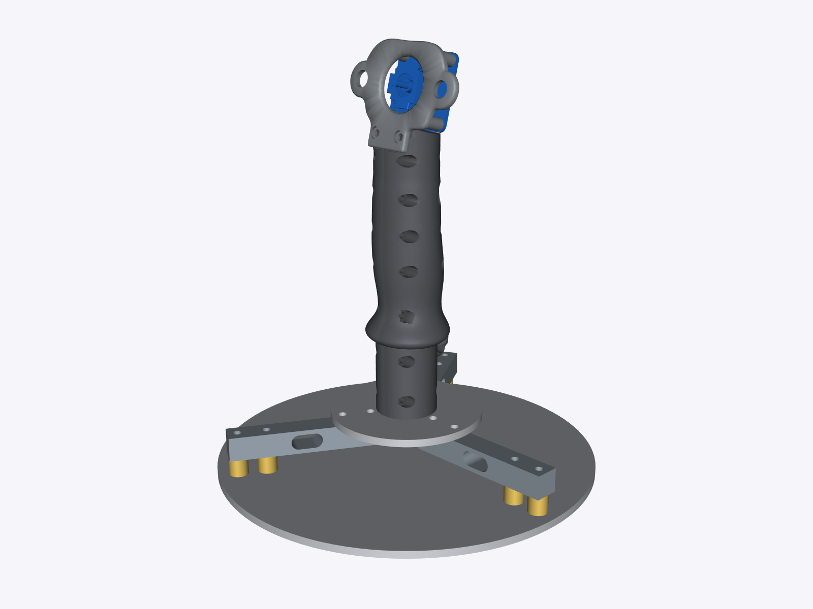

# Basic Load Cell Flight Stick

A high-precision, low-force 3-DOF force-sensing flight stick controller built around three load cells, dual 24-bit ADCs, an analog thumb mini-joystick (2 additional axis + button), two thumb buttons, and a trigger button at the resting position of your pointer finger.



This repository provides the information needed to build the joystick. It is specifically optimized for accessible materials (standard round aluminum blanks, perforated steel square tube, and aluminum angle from a hardware store) and simple workshop tools (drill, hacksaw).

The joystick is designed for left handed use (I use a mouse in my dominant right hand). You will need to modify it for right handed use.

---

## Key Features

- **3-DOF Force Sensing (Triad):** Three SparkFun TAL220 10 kg load cells placed at 0 deg, 120 deg, and 240 deg provide true Cartesian Pitch, Roll, and Z-axis force sensing.
- **Integrated Mini-Joystick:** Adafruit #512 analog 2-axis thumb joystick + push-to-select button integrated into the ergonomic thumbplate.
- **Ergonomic Hybrid Grip:** Support-free FDM 3D printed clamshell grip with snug continuous M8 spine rod bore and integrated cable conduit.
- **M8 Two-Nut Sandwich Spine:** Clamps the 4.0 mm aluminum top plate rigidly between upper and lower M8 nuts through a dia. 9.0 mm clearance hole with zero dependence on soft aluminum threads.
- **1:1 Printable Drilling Templates:** Actual-size PDF and SVG templates with dual 100 mm and 4.00-inch calibration verification rulers for error-free hole spotting.
- **Low-Cost Prototyping Electronics:** Distributed acquisition using two Adafruit ADS122C04 24-bit ADCs and an ATmega32U4 Pro Micro host running high-speed USB HID firmware.

---

## Mounting & Rig Integration

Mounting the joystick to your setup is **application-specific** (Varies based on use case: desk clamp, 2020/4040 aluminum extrusion sim rig, chair arm mount, or custom cockpit console):

- **Ideal Grounding Location:** The base plate features 3-position M5 hole pairs at r = 74.5 mm and 89.5 mm (0 deg, 120 deg, 240 deg). The ideal mounting strategy secures directly through or directly beneath these **M5 fixed load cell anchor points**.
- **Why M5 Points are Ideal:** Bolting into your rig structure at the load cell fixed ends provides the shortest, stiffest mechanical load path directly to ground. This completely eliminates base plate flexing, ensuring 100% of the hand force applied to the grip is measured directly by the strain gauges rather than lost to plate deflection.
- **Hardware Selection:** Fasteners and brackets for securing the base plate to your rig vary based on your mounting plate thickness or aluminum extrusion profile (e.g. M5 or M6 bolts with drop-in T-nuts).

---

## Quick Navigation

- [Shopping List](SHOPPING_LIST.md): Complete distilled bill of materials with vendor part numbers and links.
- [Project Roadmap & TODO](docs/TODO.md): Active development items, tips, and mechanical fit considerations.
- [Drill Bit Inventory](templates/drill_bit_inventory.md): Metric hole diameters vs. closest Imperial wire, fractional, and letter drill bits.
- [1:1 Printable Templates](templates/): Actual-size templates for the 200 mm base plate, 80 mm top plate, and brackets in PDF and SVG.
- [3D Print Ready STLs](stl/): Clean binary STLs ready to slice for 3D printing.
- [Neutral STEP CAD](step/): Standard STEP format models for FreeCAD, Fusion 360, SolidWorks, or Onshape.
- [Wiring & Harness Guide](docs/wiring.md): Modular PicoBlade quick-disconnect wiring and CAT5 trunk pinout.
- [Fasteners Specification](docs/screws.md): Exact screw lengths, M8 cut-down specs, captive nut pockets.
- [Firmware](load_cell_joystick/): Complete Arduino sketch for ATmega32U4 Pro Micro with matrix decoupling and EEPROM calibration.

---

## Repository Structure

```
basic_load_cell_joystick/
├── SHOPPING_LIST.md                  # Parts list with links
├── README.md                         # Project overview
├── Makefile                          # Model verification and audit
│
├── cad/                              # Native FreeCAD source files
│   ├── base_frame/                   # Base plate, top plate, standoffs, brackets
│   └── grips/hybrid/                 # Clamshell grip halves & mini-joystick plate
│
├── step/                             # Universal STEP models for CAD import
├── stl/                              # Binary STLs ready to 3D print
│
├── templates/                        # 1:1 Actual-size printable drilling templates
│   ├── drill_bit_inventory.md        # Metric vs Imperial drill chart
│   ├── frame_base_disk_template_letter.pdf
│   ├── frame_base_disk_template_a4.pdf
│   ├── frame_top_plate_template_letter.pdf
│   ├── frame_top_plate_template_a4.pdf
│   ├── brackets_channel_template_letter.pdf
│   ├── brackets_channel_template_a4.pdf
│   ├── svg/                          # Source vector templates
│   └── dxf/                          # 2D DXF files for laser/CNC
│
├── docs/                             # Engineering specs and assembly guides
│   ├── images/                       # Assembly screenshots and renders
│   ├── TODO.md                       # Active mechanical & firmware tasks
│   ├── SPECIFICATION.md              # Technical engineering specification
│   ├── screws.md                     # Fastener lengths, M8 cut-down & clamped spans
│   └── wiring.md                     # Cable harness & disconnect specs
│
├── electronics/                      # Carrier board documentation
│   └── sb300_carrier/README.md       # Solderable breadboard layout & track cuts
│
└── load_cell_joystick/               # Arduino firmware source
    ├── load_cell_joystick.ino        # Cooperative superloop & HID reporting
    ├── config.h                      # Hardware pinout & calibration constants
    ├── ads122c04.h                   # High-speed I2C ADC driver
    ├── decoupling.h                  # 3x3 force decoupling matrix math
    ├── calibration.h                 # EEPROM calibration routines
    └── switches.h                    # Debounced switch scanning
```

---

## License

This project is licensed under the terms of the GNU General Public License v3.0 or later (see [LICENSE](LICENSE)).
