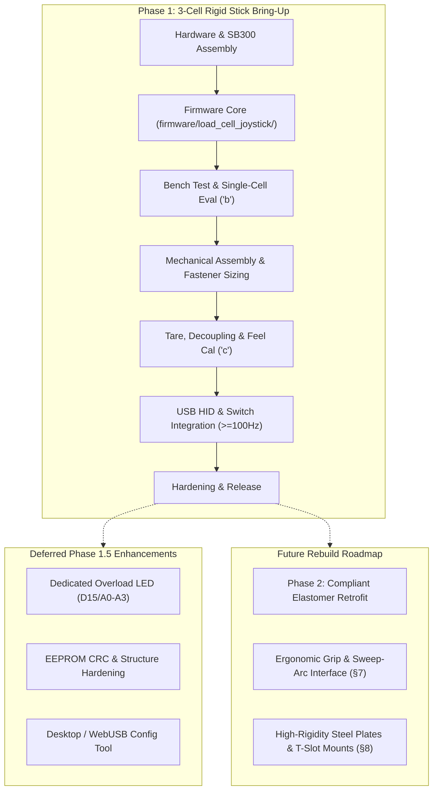
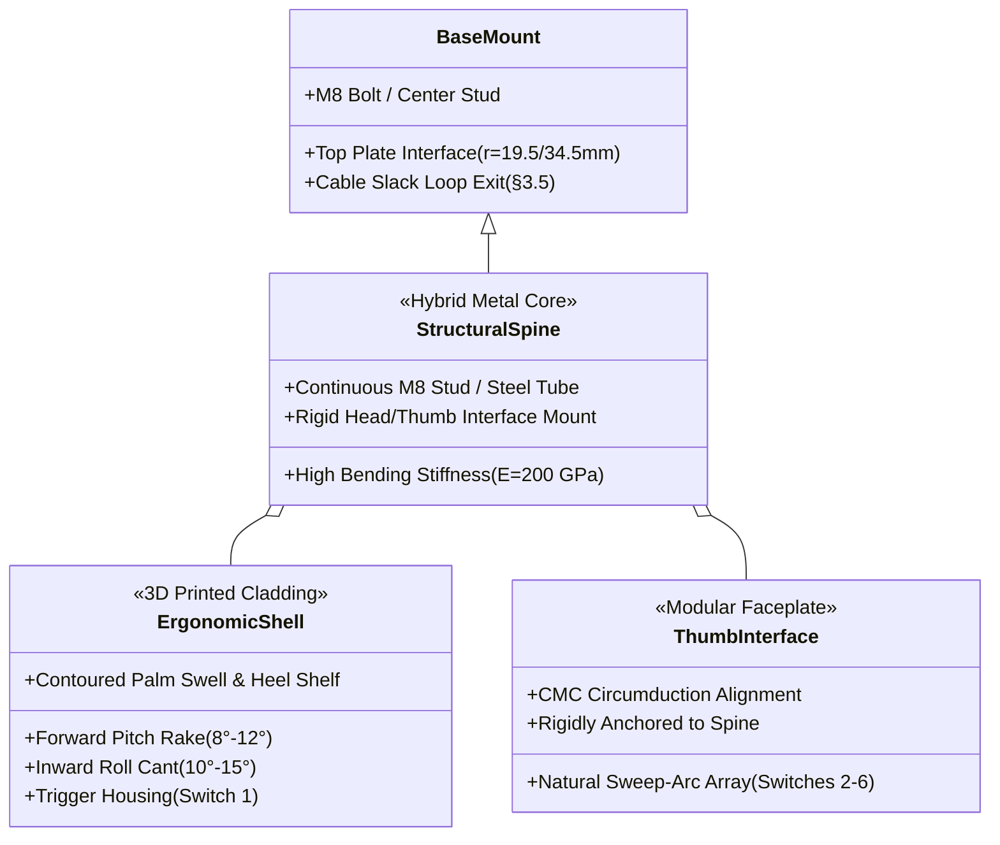
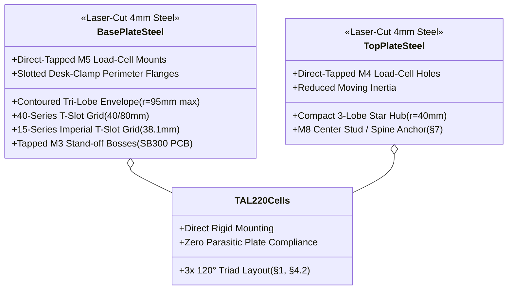

# Engineering Specification: Low-Force Load Cell Flight Stick (Phase 1)

---

## 1. System Architecture & High-Level Design

- **Operating Mode:** 3-DOF force-sensing flight stick emulating a standard USB DirectInput HID game controller.
- **Physical Boundary:** Rigid, non-deflecting mechanical stick bolted across **3** cantilever load cells.
- **Reference Frame:** viewed from above, with the plates' mounting surface at the bottom, angles φ are measured **counter-clockwise from the right-hand side** (+X).
- **Cell Mount Geometry:** the cells bolt to a **120° triad pattern** at 0°, 120°, and 240° (generated by `cad/base_frame/frame_top_plate.FCMacro` / `cad/base_frame/frame_base_plate.FCMacro`). The build populates: Cell 0 at 0° (the sideways cell on the right bracket), Cell 1 at 120° (back-left) and Cell 2 at 240° (front-left), the latter two sharing the long left bracket (§3.5). Cell angles are declared in the firmware geometry table (§4.2); with `AXIS_FORWARD_DEG = 0` (§4.12) Pitch runs along the rails and Roll across them.
- **Actuation Dynamic:** Low-force wrist/finger input.
- Pitch/Roll full deflection target: ≈300 g to 500 g hand force at grip center.
- Vertical (Z) full deflection target: ≈500 g pull force.

- **Processing Architecture:** Distributed acquisition. Two 24-bit ADCs manage low-level sensor excitation, PGA gain, and conversion, streaming decoupled raw counts to an ATmega32U4 host over a shared I2C bus.

```
                  +-----------------------------------+
                  |          PC Operating System      |
                  |       (DirectInput HID Device)    |
                  +-----------------+-----------------+
                                    ^
                                    | USB (Full-Speed HID Reports @ >=100Hz)
                                    v
                  +-----------------+-----------------+
                  |     Pro Micro (3.3V / 8MHz)       |
                  | - USB HID report packaging   |
                  | - Decoupling math & deadzone |
                  | - 2-phase DRDY sampling seq. |
                  | - Tare / Calibration storage |
                  | - Switch debouncing (CAT5)   |
                  +--------+-----------------+--------+
                           |                 |
     Shared Fast I2C Bus   |                 | Digital GPIO (INPUT_PULLUP)
     (222 kHz, SDA:2, SCL:3|                 |
      DRDY: D16 & D10)     |                 |
             +-------------+                 +---------------+
             |                                               |
             v                                               v
    +--------+------------+                         +--------+------------+
    | Adafruit 6432 (#1)  |                         |  SparkFun BOB-00716 |
    | Address: 0x40       |                         |    RJ45 Breakout    |
    | - Ch 1: Cell 0  0°  |                         | - 6x Grip Switches  |
    | - Ch 2: Cell 1 120° |                         | - Common Ground     |
    +--------+------------+                         +---------------------+
             | STEMMA / Perfboard Parallel Bus
             v
    +--------+------------+
    | Adafruit 6432 (#2)  |
    | Address: 0x41 (A0)  |
    | - Ch 1: Cell 2 240° |
    | - Ch 2: Unused      |
    +---------------------+

```

---

## 2. Hardware Bill of Materials (Locked Specs)

| Subsystem               | Component                          | Manufacturer / Part #                                                                    | Electrical / Physical Parameters                                                                                                                                                                                                  |
| ----------------------- | ---------------------------------- | ---------------------------------------------------------------------------------------- | --------------------------------------------------------------------------------------------------------------------------------------------------------------------------------------------------------------------------------- |
| **Microcontroller**     | Pro Micro (3.3V / 8 MHz)           | SparkFun DEV-12587 / Clone                                                               | ATmega32U4, 3.3V logic, Native USB                                                                                                                                                                                                |
| **ADC Converters**      | Dual ADS122C04 Breakouts           | Adafruit PID 6432 (x2)                                                                   | 24-bit ΔΣ, PGA 1×-128×, I2C `0x40` & `0x41`                                                                                                                                                                                       |
| **Sensors**             | 3x Straight-Bar Load Cells         | SparkFun SEN-13329 (TAL220)                                                              | 10 kg capacity, 1.0 mV/V, 80 × 12.7 × 12.7 mm, M4/M5. 3 fitted as the 0°/120°/240° triad                                                                                                                                          |
| **Cell Interconnect**   | Per-cell load-cell connectors      | 3x Molex KK 254 (0.1") 4-pin keyed headers (male) + matching crimp housings & crimp pins | **3 populated.** One keyed 4-wire connection per cell (`E+`/`E-`/`S+`/`S-`), swappable without desoldering. True 2.54 mm system; keying prevents reversed insertion. **JST-XH is 2.5 mm** - not compatible                        |
| **MCU Reset Interface** | External reset & bootloader header | 1x Molex KK 254 (0.1") 2-pin keyed header (male) + matching crimp housing & pins         | Keyed 2-pin connection (`RST` / `GND`) landed on SB300 Row 11 cols 28-29 for off-board reset switch or service double-tap to enter Leonardo/Pro Micro bootloader                                                                  |
| **Prototyping Base**    | Breadboard-Style PCB               | BusBoard Systems SB300                                                                   | Single-sided 0.1" DIP grid: 360 holes, 30 columns × 12 rows (two 5-row banks + 2 centerline power rails), 3.00" × 1.20"                                                                                                           |
| **Grip I/O Interface**  | RJ45 Breakout (PCBA only)          | SparkFun BOB-00716 + RJ45 8-pin socket (SparkFun PRT-00643)                              | 8P8C jack pins 1-8 broken out **1:1** to an in-line 0.1" header; 0.7" × 0.8". Mounted on-board SB300 row 2 (cols 19-26) with jack overhanging top edge. **Not** a MagJack (no magnetics); socket must be soldered to the breakout |
| **MCU Socketing**       | Swiss Machined Headers             | Adafruit PID 3646 & 3647                                                                 | Low-profile round gold contacts, 0.1" pitch                                                                                                                                                                                       |

---

## 3. Electrical & Interconnect Mapping

### 3.1 Pro Micro Pin Allocation

> **Pin naming.** Pins are listed here as the **Arduino pin number** - which is how the SparkFun _Pro Micro & Fio V3 Hookup Guide_ pinout diagram labels the header - followed by SparkFun's **`D`-designator** and the **ATmega32U4 port pin**. All three name the _same_ physical pin: e.g. `D4` = Arduino `4` = `PD4`. The board silkscreen and SparkFun's pinout card print the `D`-designator; the hook-up guide prints the bare number without the `D`, which is why "`D4`" is not found there. Note the Arduino number is **not** the physical position on the header (the pins are not in numeric order) - match by label/function, not by counting holes.

- **`Pin 2` (SDA):** I2C Data bus linked to `SDA` on both Adafruit 6432 breakouts.
- **`Pin 3` (SCL):** I2C Clock bus linked to `SCL` on both Adafruit 6432 breakouts.
- **`Pin 4` (`D4` / `PD4`):** Digital Input, Button 1 / Trigger (pointer finger).
- **`Pin 5` (`D5` / `PC6`):** Digital Input, Button 2 / Left Flanking Button (thumb).
- **`Pin 6` (`D6` / `PD7`):** Digital Input, Button 3 / Right Flanking Button (thumb).
- **`Pin 7` (`D7` / `PE6`):** Digital Input, Button 4 / Mini-Joystick Push Select Switch (thumb).
- **`Pin 8` (`D8` / `PB4` / `A8`):** Analog Input, Mini-Joystick Vertical (Y) Axis (`MINIJOY_PIN_YOUT`).
- **`Pin 9` (`D9` / `PB5` / `A9`):** Analog Input, Mini-Joystick Horizontal (X) Axis (`MINIJOY_PIN_XOUT`).
- **`Pin 16` (`D16` / `PB2`):** Digital Input, `DRDY` from Adafruit 6432 #1 (`0x40`), active-low, MCU internal pull-up enabled.
- **`Pin 10` (`D10`):** Digital Input, `DRDY` from Adafruit 6432 #2 (`0x41`), active-low, MCU internal pull-up enabled.
- **Arduino `Pin 14` (`D14` / `PB3`, MISO):** _(Optional)_ Digital Output, shared `!RST` for both ADS122C04 breakouts (active-low reset).
- **`VCC` (3.3V):** Master supply line driving the SB300 centerline `+` rail (ADC `VIN`, load-cell excitation `E+`, mini-joystick potentiometer `VCC`).
- **`GND`:** Master ground return driving the SB300 centerline `-` rail (ADC `GND`, load-cell `E-`, mini-joystick `GND`).

**Grip switch & analog pin cross-reference (Mini-Joystick Plate, hw-v1.1)**

| Grip control                   | Board / `D`-designator | Arduino pin (hook-up guide) | ATmega32U4 | Analog alias | Signal type            |
| ------------------------------ | ---------------------- | --------------------------- | ---------- | ------------ | ---------------------- |
| Button 1 - Trigger (pointer)   | `D4`                   | 4                           | `PD4`      | `A6`         | Digital (INPUT_PULLUP) |
| Button 2 - Left Flank (thumb)  | `D5`                   | 5                           | `PC6`      | -            | Digital (INPUT_PULLUP) |
| Button 3 - Right Flank (thumb) | `D6`                   | 6                           | `PD7`      | `A7`         | Digital (INPUT_PULLUP) |
| Button 4 - Stick Select Click  | `D7`                   | 7                           | `PE6`      | -            | Digital (INPUT_PULLUP) |
| Mini-Joystick Vertical (Y)     | `D8`                   | 8                           | `PB4`      | `A8`         | Analog (0-3.3V)        |
| Mini-Joystick Horizontal (X)   | `D9`                   | 9                           | `PB5`      | `A9`         | Analog (0-3.3V)        |

> **Silkscreen caveat:** the hook-up guide prints its "swapped `D14`/`D17` silkscreen" warning on the _Fio v3_ page, but the swap is a genuine Pro Micro issue too (SparkFun's schematic changelog notes a corrected `D14` silk; there is an open SparkFun issue on the `14`/`17` schematic labels). It affects only the SPI pins (`D14`-`D17`), **not** the `D4`-`D9` grip inputs, so it does not change this design - but on a board with the uncorrected silk, match those SPI pins by function, not by printed label.

**Free / unused I/O:** Arduino pins `0` (`D0`), `1` (`D1`) (UART), `15` (`D15`, SCK), `18` (`A0`), `19`-`21` (`A1`-`A3`). (`D17`/`PB0` drives the on-board RX LED and is reserved for the overload indicator, §4.13.)

> **Interrupt note:** the ATmega32U4's four true external-interrupt inputs map to `D3`/INT0, `D2`/INT1, `D0`/INT2 and `D1`/INT3. With `D2`/`D3` committed to I²C, the two `DRDY` lines are serviced by level polling in the main scheduler (optionally via pin-change interrupts: `D16`/`PCINT2` and `D10`/`PCINT6` are both in the same PORTB / `PCIE0` group, so a single ISR covers both) rather than hardware interrupts. (`Ref:` SparkFun _Pro Micro & Fio V3 Hookup Guide_; ATmega32U4 datasheet, `PCINT`/`INT` mapping.)

### 3.2 Sensor & ADC Channel Wiring

Load-cell excitation is powered from the Pro Micro **3.3V rail**, not from an ADC breakout pin: the Adafruit 6432 exposes only `VIN`, `Ref+`, `GND` and `Ref-` (there is no `3V` output). The bridges are wired **ratiometrically** - `E+`, the breakout `Ref+`, and the 3.3V rail form one common node; `E-`, `Ref-`, and `GND` are the return. The ADS122C04 is then set to `VREF = 0b01` (external `REFP`/`REFN`), so bridge and reference share the same excitation and supply/thermal drift cancels.

> **Design note:** the TAL220 is specified for 5-10 V excitation with a rated output of 1.0 ± 0.15 mV/V. 3.3 V is used so a single rail drives both the ADC `AVDD` and the bridges, keeping the PGA input common-mode near (AVSS + AVDD)/2 = 1.65 V as required. At 3.3 V excitation the cell output is ≈3.3 mV at rated 10 kg and ≈0.165 mV at 500 g; at gain 128× the full-scale input range is ±V_REF/Gain = ±25.8 mV, leaving ample headroom and resolution. (The 500 g figure is the **single-cell reference**. In the triad, a 500 g Z pull splits ≈167 g per cell, while Pitch/Roll leverage at h_grip = 80 mm loads the worst cell to ≈0.6-1.1 kg across the 300-500 g operating range - see §3.5 for the overload envelope.) (`Ref:` TAL220 datasheet; ADS122C04 datasheet SBAS751B §8.3.2.1 and the FSR definition.) A separate 5 V excitation rail is a possible Phase 2 refinement.

**Data-ready handshaking:** each breakout's `DRDY` output (active-low) is wired to `D16` / `D10` respectively. The ADS122C04 `DRDY` pin is an **open-drain** output that must be pulled up (the pin table says "Connect to DVDD using a pullup resistor"), so firmware enables the MCU internal pull-ups on those pins. (`Ref:` SBAS751B §8.5.1.3 "Data Ready (DRDY)", pin description table, and §9.1.3.)

**Breakout electrical notes** (`Ref:` Adafruit ADS122C04 guide, PID 6432):

- `VIN` accepts 2.5-5 VDC - power it from the same 3.3V logic rail as the bridge.
- `SDA`/`SCL` each carry an on-board **10 kΩ pull-up**, so two breakouts present ≈5 kΩ to the bus and **no external I²C pull-ups are required** at the 222 kHz bus speed (§4.5). That pair meets the 300 ns fast-mode rise limit only while total bus capacitance stays under ≈70 pF (§4.5).
- The board exposes **two** address jumpers, `A0` and `A1` (up to four boards per bus). Close `A0` on the second board for `0x41`; leave `A1` open on both. Default (both open) is `0x40`.
- `DRDY` is an active-low output; `!RST` is active-low reset (pull low to reset).
- The guide's _Strain Gauge Load Cell_ example corroborates this design's wiring exactly: `Ref+` to the excitation rail and cell `E+`, `Ref-` to `GND`/`E-`, external reference - i.e. the bridge is measured and referenced ratiometrically.

```
Common to both breakouts:
├── VIN  -> SB300 +3.3V rail (row 7)
├── GND  -> SB300 ground rail (row 6)
├── Ref+ -> SB300 +3.3V rail (row 7, same node as load-cell E+)
└── Ref- -> SB300 ground rail (row 6, same node as load-cell E-)

Load cells (3 fitted; 4th held as a spare for the future 90° build, §4.2):
E+ = Red, E- = Black, S+ = Green, S- = White
(TAL220 wire code; confirms the S+/S- colours below)

Adafruit 6432 #1 (I2C Address: 0x40 - Solder Jumper A0 Open, SB300 Cols 1-6)
├── Diff Pair 1 (AIN3 / AIN2 - MUX 0x7): Cell 0 (0°)   (S+ = Green / AIN3, S- = White / AIN2)
└── Diff Pair 0 (AIN1 / AIN0 - MUX 0x3): Cell 1 (120°) (S+ = Green / AIN1, S- = White / AIN0)

Adafruit 6432 #2 (I2C Address: 0x41 - Solder Jumper A0 Bridged, SB300 Cols 11-16)
├── Diff Pair 1 (AIN3 / AIN2 - MUX 0x7): Cell 2 (240°) (S+ = Green / AIN3, S- = White / AIN2)
└── Diff Pair 0 (AIN1 / AIN0 - MUX 0x3): Unused channel (tied off / idle)
```

> **Zero-crossover hardware routing note:** Using the ADS122C04's native inverted differential multiplexer options (`MUX = 0b0111` for Pair 1, `MUX = 0b0011` for Pair 0 per SBAS751B Table 19) performs hardware (AIN_P - AIN_N) subtraction directly in the ADC. This allows `S+` to land on the left ADC pin (`AIN3` / `AIN1`) and `S-` on the right ADC pin (`AIN2` / `AIN0`), matching the left-to-right (`S+`, `S-`) order of the Row 11 Molex headers so all jumper pairs run strictly in parallel side-by-side with zero wire crossovers. Downward deflection produces identical positive counts with zero software negation tricks.

**Two shared supply nets.** All populated cells (3 in Phase 1, or 4 in a future 90°-grid build, §4.2) and both breakouts share exactly **two** power nets - it is _not_ one net per ADC:

```
3.3 V net :  Pro Micro VCC (3.3V) ── SB300 row-7 rail ─┬─ ADC #1 VIN    (AVDD)
                                                       ├─ ADC #1 Ref+   (reference sense)
                                                       ├─ ADC #2 VIN
                                                       ├─ ADC #2 Ref+
                                                       └─ E+ (red) x N cells (excitation)

GND net   :  Pro Micro GND ── SB300 row-6 rail ────────┬─ ADC #1 GND
                                                       ├─ ADC #1 Ref-
                                                       ├─ ADC #2 GND
                                                       ├─ ADC #2 Ref-
                                                       └─ E- (black) x N cells
```

Four distinct functions ride on those two nets:

| Pins on the net             | Function              | Notes                                                                                                                                       |
| --------------------------- | --------------------- | ------------------------------------------------------------------------------------------------------------------------------------------- |
| `VIN` (both ADCs)           | Chip power (`AVDD`)   | Carries the ADC supply current.                                                                                                             |
| `E+` / `E-` (all cells)     | Bridge excitation     | The actual current path: 3.3 V → `E+` → bridge → `E-` → GND. TAL220 input R ≈ 1000 Ω ⇒ ≈3.3 mA per cell (≈10 mA for 3 cells, ≈13 mA for 4). |
| `Ref+` / `Ref-`             | Measurement reference | Internally buffered / high-Z - _senses_ the rail and draws essentially no current.                                                          |
| `S+` / `S-` (green / white) | **Not** on these nets | Differential signal pairs → `AIN0`-`AIN3`.                                                                                                  |

Why they must be one node (not merely convenient):

- **Ratiometric cancellation:** because the reference (`Ref+`) and the bridge excitation (`E+`) are the same node, any drift or sag on the 3.3V rail scales the reference and the bridge output together, so it cancels in the conversion ratio.
- **PGA common-mode:** with `AVDD = VIN = 3.3V` and the bridges excited at the same 3.3V, each bridge midpoint sits at `AVDD/2 = 1.65V` - exactly where the input PGA (gain 128×) requires its common-mode voltage. Powering `VIN` from a different rail (e.g. 5V) would move `AVDD/2` away from the bridge midpoint and violate the PGA input range.
- **Reference is high-Z:** only `E+`/`E-` carry the bridge current; `Ref+`/`Ref-` only sense the excitation - that is what makes the measurement ratiometric. Strictly, `Ref±` is tapped **at the board**, not at the bridge, so this is not true 4-wire remote sensing at the cell; the lead-resistance error from that choice is negligible here, but the distinction is worth stating.

> **Build caveat:** do **not** cut the SB300 row-6/row-7 rails between an ADC's `VIN`/`Ref+` tap and any cell's `E+` tap. Isolating a rail segment would break the shared node for that cell and defeat ratiometric cancellation.

**Cell interconnect:** each TAL220 terminates in a **4-pin 0.1" crimp housing** that plugs onto a matching header on the SB300, so a cell can be swapped **without desoldering**. `E+`/`E-` are tapped from the row 6/7 rails at the header; `S+`/`S-` run as a twisted pair to the assigned ADC channel.

**Connector pin order (per cell, Molex KK 254):**

| Pin | Signal | TAL220 wire | Terminates at              |
| --- | ------ | ----------- | -------------------------- |
| 1   | `E+`   | red         | SB300 row 7 (`+3.3V` rail) |
| 2   | `E-`   | black       | SB300 row 6 (`GND` rail)   |
| 3   | `S+`   | green       | ADC `AINn` (even input)    |
| 4   | `S-`   | white       | ADC `AINn` (odd input)     |

_Ordering rule - group by function:_ put the excitation pair (`E+`/`E-`) on the end of the header nearest rows 6/7 so the two rail jumpers run as a short, parallel, equal-length pair; put the signal pair (`S+`/`S-`) on the end toward the ADC channel so the twisted pair leaves cleanly without looping back over the power pins. Use the **same order on all four headers and cell housings** (3 populated + 1 spare), so any cell can plug into any channel - this keeps the cells sign-consistent for the §4.2 reconstruction matrix. Because KK 254 is keyed, a reversed insert is physically prevented (see _Keying / pin 1_).

- **Pitch:** true 2.54 mm system; **Molex KK 254** selected (male pin header on the board + crimp housing on the cell). (Molex SL or DuPont also fit, but KK 254 is the chosen keyed part.) **JST-XH is 2.5 mm** - it mates a 2.5 mm header, not a 0.1" one.
- **Keying / pin 1:** mark pin 1 on both header and housing. **Molex KK 254 is keyed/polarized**, so a housing can only seat one way - the reversal failure mode is physically prevented. If a non-keyed 2.54 mm housing is ever substituted, reversing `S+`/`S-` would invert that cell's sign, which the decoupling math (§4.2) assumes is known.
- **Crimp, don't tin:** TAL220 conductors are ~28-30 AWG - crimp pins rather than inserting tinned stranded wire.
- **Routing:** keep `S+`/`S-` twisted and route them clear of the I²C `SCL` line and other digital traces (the dominant aggressors for a sub-millivolt signal). The grip-button harness (§3.4, CAT5) is a secondary "keep clear" item if the run happens to pass near it - it is unrelated to the cell cabling. Add a **strain-relief** anchor and a small **service loop** at the board end. The cell leads exit at the **fixed M5 (base) end** of each cell (§3.5) - they do not hang down from the disk above.
- **Shielded variant:** if the shielded TAL220 cable is used, terminate its shield/drain to board `GND` at the **board end only**.

### 3.3 SB300 Board Layout & Component Placement

The entire joystick acquisition, MCU host, sensor headers, and grip switch interface consolidate onto a **single BusBoard Systems SB300 solderable breadboard**.

**Board geometry** (`Ref:` BPS SB300 datasheet): 30 columns × 12 rows = 360 holes, 3.00" × 1.20" (76.2 × 30.5 mm). Rows 1-5 (top bank) and Rows 8-12 (bottom bank) consist of 5-hole vertical strips joined by 0.040" copper tracks; rows 6-7 are the two centerline power rails running horizontally across columns 1-30 (Row 6 = `GND`, Row 7 = `+3.3V`).

#### A. Macro Component Placement Matrix (12 Rows × 30 Columns)

```text
Col:    01 02 03 04 05 06 07 08 09 10 11 12 13 14 15 16 17 18 19 20 21 22 23 24 25 26 27 28 29 30
-------------------------------------------------------------------------------------------------
Row 01:  .  .  .  .  .  .  .  .  .  .  .  .  .  .  .  .  .  . [--RJ45 Jack Overhang-]  .  .  .  .
Row 02:  .  .  .  .  .  .  .  .  .  .  .  .  .  .  .  .  .  . [---RJ45 (BOB-00716)--]  .  .  .  .
Row 03: [--ADC1 JP2 Dig-]  .  .  .  . [--ADC2 JP2 Dig-]  .  .  .  .  .  .  .  .  .  .  .  .  .  .
Row 04: [--ADC1-PCB-Bdy-]  .  .  .  . [--ADC2-PCB-Bdy-]  .  . D9 D8 D7 D6 D5 D4 03 02 GD GD RX TX
Row 05: [--ADC1-PCB-Bdy-]  .  .  .  . [--ADC2-PCB-Bdy-]  .  . [--Pro Micro Board Body / Belly---]
Row 06: =============================== GND Centerline Rail =====================================
Row 07: ============================== +3.3V Centerline Rail ====================================
Row 08: [--ADC1 JP1 Ana-]  .  .  .  . [--ADC2 JP1 Ana-]  .  . [--Pro Micro Board Body / Belly---]
Row 09: [-ADC1 Ana Tie--]  .  .  .  . [-ADC2 Ana Tie--]  .  . [--Pro Micro Board Body / Belly---]
Row 10: [--LC0-tp-] [--LC1-tp-] [--LC2-tp-] [---idle---]  .  . 10 16 14 15 A0 A1 A2 A3 3V RS GD RW
Row 11: [---LC0---] [---LC1---] [---LC2---] [---idle---]  .  .  .  .  .  .  .  .  .  .  . [-RST-]  .
Row 12:  .  .  .  .  .  .  .  .  .  .  .  .  .  .  .  .  .  .  .  .  .  .  .  .  .  .  .  .  .  .
```

#### B. Micro Pin-by-Pin Coordinate Matrix

```text
Col:    01 02 03 04 05 06 07 08 09 10 11 12 13 14 15 16 17 18 19 20 21 22 23 24 25 26 27 28 29 30
-------------------------------------------------------------------------------------------------
Row 01:  .  .  .  .  .  .  .  .  .  .  .  .  .  .  .  .  .  . :: :: :: :: :: :: :: ::  .  .  .  .
Row 02:  .  .  .  .  .  .  .  .  .  .  .  .  .  .  .  .  .  . B6 B5 B4 B3 B2 B1 GD GD  .  .  .  .
Row 03: !R DY DA CL GD 3V  .  .  .  . !R DY DA CL GD 3V  .  .  .  .  .  .  .  .  .  .  .  .  .  .
Row 04: :: :: :: :: :: ::  .  .  .  . :: :: :: :: :: ::  .  . D9 D8 D7 D6 D5 D4 03 02 GD GD RX TX
Row 05: :: :: :: :: :: ::  .  .  .  . :: :: :: :: :: ::  .  . :: :: :: :: :: :: :: :: :: :: :: ::
Row 06: =============================== GND Centerline Rail =====================================
Row 07: ============================== +3.3V Centerline Rail ====================================
Row 08: R- A3 A2 A1 A0 R+  .  .  .  . R- A3 A2 A1 A0 R+  .  . :: :: :: :: :: :: :: :: :: :: :: ::
Row 09: r- a3 a2 a1 a0 r+  .  .  .  . r- a3 a2 a1 a0 r+  .  . :: :: :: :: :: :: :: :: :: :: :: ::
Row 10: e+ e- s+ s- e+ e- s+ s- e+ e- s+ s- e+ e- s+ s-  .  . 10 16 14 15 A0 A1 A2 A3 3V RS GD RW
Row 11: E+ E- S+ S- E+ E- S+ S- E+ E- S+ S- E+ E- S+ S-  .  .  .  .  .  .  .  .  .  .  . RS GD  .
Row 12:  .  .  .  .  .  .  .  .  .  .  .  .  .  .  .  .  .  .  .  .  .  .  .  .  .  .  .  .  .  .
```

**Legend:**

- `.` : Empty unpopulated breadboard hole.
- `::` : Component body clearance / overhang (no pin soldered in hole).
- `B6`..`B1` : Grip buttons 6 down to 1 (RJ45 pins 1-6); `GD` : Common Ground (RJ45 pins 7-8).
- `!R`, `DY`, `DA`, `CL`, `GD`, `3V` : ADC JP2 pins (`!RESET`, `!DRDY`, `SDA`, `SCL`, `GND`, `VIN`).
- `D9`..`D4`, `03` (SCL), `02` (SDA), `GD` (GND), `RX`, `TX` : Pro Micro Row 4 pins.
- `R-`, `A3`, `A2`, `A1`, `A0`, `R+` : ADC JP1 pins soldered in Row 8 (`Ref-`, `AIN3`, `AIN2`, `AIN1`, `AIN0`, `Ref+`).
- `r-`, `a3`, `a2`, `a1`, `a0`, `r+` : Open solder tie-holes in Row 9 connected to Row 8 ADC pins.
- `e+`, `e-`, `s+`, `s-` : Open solder tie-holes in Row 10 connected to Row 11 Load Cell Header pins.
- `E+`, `E-`, `S+`, `S-` : Load cell pins soldered in Row 11 (Molex KK 254 headers).
- `10` (DRDY #2), `16` (DRDY #1), `14` (!RST/MISO), `15` (SCK), `A0`..`A3`, `3V` (VCC), `RS`, `GD`, `RW` (RAW) : Pro Micro Row 10 pins.
- `[-RST-]` / `RS GD` (Row 11 cols 28-29) : 2-pin Molex KK 254 reset header (`RST` on col 28, `GND` on col 29).

#### Component Placement & Clearances

| Zone                                               | Component                                      | Placement & Mechanical Clearance                                                                                                                                                                                                                                                                                                                                                                                                                                                                                                                                                                                                                                                                                                                                                                                                                                                                                     |
| :------------------------------------------------- | :--------------------------------------------- | :------------------------------------------------------------------------------------------------------------------------------------------------------------------------------------------------------------------------------------------------------------------------------------------------------------------------------------------------------------------------------------------------------------------------------------------------------------------------------------------------------------------------------------------------------------------------------------------------------------------------------------------------------------------------------------------------------------------------------------------------------------------------------------------------------------------------------------------------------------------------------------------------------------------- |
| **Row 2, cols 19-26**                              | SparkFun BOB-00716 (RJ45 Breakout)             | 8-pin in-line header soldered along Row 2 with Pin 1 (Button 6) on col 19 and Pin 8 (GND) on col 26. Pins 1-6 align directly over Pro Micro pins `D9`-`D4` in Row 4. The RJ45 socket body extends upward across Row 1 and overhangs the top edge of the SB300 cleanly into open space.                                                                                                                                                                                                                                                                                                                                                                                                                                                                                                                                                                                                                               |
| **Rows 3 & 8, cols 1-6**                           | Adafruit 6432 #1 (`0x40`)                      | Rotated 180°. Row 3 carries digital/power pins JP2 (`!RESET` col 1, `!DRDY` col 2, `SDA` col 3, `SCL` col 4, `GND` col 5, `VIN` col 6). Row 8 carries analog pins JP1 (`Ref-` col 1, `AIN3` col 2, `AIN2` col 3, `AIN1` col 4, `AIN0` col 5, `Ref+` col 6). Elevated PCB body spans rows 4-7. `A0` address jumper left open (`0x40`).                                                                                                                                                                                                                                                                                                                                                                                                                                                                                                                                                                                |
| **Rows 3 & 8, cols 11-16**                         | Adafruit 6432 #2 (`0x41`)                      | Rotated 180°. Row 3 carries digital/power pins JP2 (`!RESET` col 11 to `VIN` col 16). Row 8 carries analog pins JP1 (`Ref-` col 11 to `Ref+` col 16). PCB spans cols 11-16, clearing Pro Micro pins by 0.05" (1.27 mm). `A0` address jumper bridged closed (`0x41`).                                                                                                                                                                                                                                                                                                                                                                                                                                                                                                                                                                                                                                                 |
| **Rows 4 & 10, cols 19-30**                        | Pro Micro (3.3V / 8 MHz, socketed)             | Standard 0.60" DIP span landed across Row 4 (Left header: `Pin 9` / `D9` col 19 to `Pin 1` / `TXO` col 30) and Row 10 (Right header: `Pin 10` col 19 to `RAW` col 30). Straddles centerline power rails 6-7 with zero pin contact to rails. USB port points right toward the board edge (col 30).                                                                                                                                                                                                                                                                                                                                                                                                                                                                                                                                                                                                                    |
| **Row 11, cols 1-12**                              | 3x Load Cell Headers (Molex KK 254 4-pin male) | Sequential left-to-right along Row 11: **LC0** (cols 1-4), **LC1** (cols 5-8), **LC2** (cols 9-12). Pin 1 is `E+` on the leftmost pin of each header (cols 1, 5, 9). Positioned along Row 11 on the same Bottom Bank as the ADC analog inputs.                                                                                                                                                                                                                                                                                                                                                                                                                                                                                                                                                                                                                                                                       |
| **Row 11, cols 28-29**                             | MCU Reset Header (Molex KK 254 2-pin male)     | Keyed 2-pin header for Pro Micro hardware reset: Pin 1 (`RST`) on col 28 and Pin 2 (`GND`) on col 29. Lands directly on the SB300 vertical copper traces under Pro Micro socket pins `RS` (col 28) and `GD` (col 29) with **zero jumper wires**. Provides external access to pull `RST` to `GND` for manual reset or double-tapping to enter the bootloader.                                                                                                                                                                                                                                                                                                                                                                                                                                                                                                                                                         |
| **Rows 6 & 7, cols 7-8, 17-18, 27-28**             | 3x Ceramic Decoupling Capacitors (0.1 µF)      | 0.1 µF (100 nF) ceramic MLCC decoupling capacitors placed directly across Row 6 (GND) and Row 7 (+3.3V) rails for high-frequency bypassing: adjacent to ADC #1 (cols 7-8), adjacent to ADC #2 (cols 17-18), and under/adjacent to MCU VCC (cols 27-28).                                                                                                                                                                                                                                                                                                                                                                                                                                                                                                                                                                                                                                                              |
| **Rows 6 & 7, cols 29-30 (or Row 9 cols 27 & 29)** | 1x Bulk Storage Capacitor (10 µF-47 µF)        | 10 µF-47 µF electrolytic or tantalum bulk reservoir capacitor placed across **VCC (+3.3V)** and **GND** (NOT RAW). Bridges directly at the regulator power entry to stabilize the 3.3V bus against USB burst transients and LDO load steps (high-frequency switching noise at the ADCs and load cells is separately handled by the distributed 0.1 µF MLCC decoupling caps).<br>• **Option A (Underside Centerline Rails - Recommended):** Solder directly across Row 6 (GND rail) and Row 7 (+3.3V rail) at cols 29-30 on the solder side to avoid mechanical clearance issues under the socketed Pro Micro.<br>• **Option B (Top Side Row 9):** Negative lead in Row 9 col 29 (GND) and positive lead in Row 9 col 27 (VCC). Utilizes existing SB300 vertical copper tracks to Row 10 with zero jumper wires and zero track cuts. _(Do NOT place across Row 9 cols 29 & 30, as Row 10 col 30 connects to RAW/5V)._ |

#### Mandatory SB300 Track Cutting Schedule

> [!CAUTION]
> In the BusBoard Systems SB300, vertical holes in Rows 1-5 and Rows 8-12 are joined by 0.040" copper tracks. The following two track cuts are **strictly mandatory** to prevent catastrophic short circuits:
>
> 1. **Top Bank RJ45 Ground Isolation (Rows 1-5, Columns 25 and 26):**
>
> - **Action:** Sever the 0.040" copper track between **Row 2 and Row 4** on **Column 25 and Column 26**.
> - **Reason:** Row 2 carries RJ45 Pin 7 (`GND`) on col 25 and Pin 8 (`GND`) on col 26. Row 4 carries Pro Micro Pin 3 (`SCL`) on col 25 and Pin 2 (`SDA`) on col 26. Severing between Row 2 and Row 4 isolates the switch grounds from the I2C bus lines.
> - **Leave Intact:** On **Columns 19 through 24**, **LEAVE TRACKS INTACT**. The built-in SB300 tracks connect RJ45 Pins 1-6 (Buttons 6-1) directly to Pro Micro `D9`-`D4` with **zero jumper wires required**!
>
> 2. **Bottom Bank Load Cell to ADC Isolation (Rows 8-12, Columns 1 through 16):**
>
> - **Action:** Sever the 0.040" copper track between **Row 9 and Row 10** across **Columns 1 through 16**.
> - **Reason:** Isolates the Load Cell Header domain (Rows 10-12) from the ADC analog domain (Rows 8-9). This cut leaves Row 10 as open tie-holes for the load cell pins and Row 9 as open tie-holes for the ADC inputs, enabling short, direct jumpers across the 0.1" gap between Row 10 and Row 9!

#### Complete Interconnect & Jumper Wiring Schedule

- [x] **1. Master Power & Centerline Rails:**
- Pro Micro Row 10 col 27 (`VCC` / 3.3V) -> Jumper to Row 7 rail (+3.3V).
- Pro Micro Row 10 col 29 or Row 4 cols 27-28 (`GND`) -> Jumper to Row 6 rail (`GND`).
- Bulk Storage Capacitor (10 µF-47 µF): Connect across `+3.3V` (VCC) and `GND` at cols 27-30 (across Row 6 and Row 7 on the underside, or top side across Row 9 cols 27 and 29). Observe capacitor polarity (negative stripe to Row 6 / GND).
- ADC #1 / #2: Row 3 cols 6 & 16 (`VIN`) and Row 8 cols 6 & 16 (`Ref+`) to Row 7 rail (+3.3V). (Note: Row 8 col 6/16 `Ref+` is directly adjacent to Row 7 rail!).
- ADC #1 / #2: Row 3 cols 5 & 15 (`GND`) and Row 8 cols 1 & 11 (`Ref-`) to Row 6 rail (`GND`).
- Load Cell Excitation: Row 10 or 11 pins 1 (`E+`, red) and 2 (`E-`, black) run under the board directly to Row 7 (+3.3V) and Row 6 (`GND`) rails.
- MCU Hardware Reset Interface: 2-pin Molex KK 254 header at Row 11 cols 28-29 connects directly to Pro Micro Row 10 col 28 (`RST`) and col 29 (`GND`) via existing SB300 vertical copper traces (zero jumper wires). Provides off-board reset switch or double-tap bootloader entry access.
- [x] **2. RJ45 Grip Buttons:**
- Cols 19-24: Connected internally via SB300 copper tracks between Row 2 and Row 4. Zero jumpers required.
- Cols 25-26: Jumper from Row 2 col 25/26 (RJ45 Pins 7 & 8) to Row 6 (`GND` rail) to provide common ground return for the grip switches.
- [x] **3. I2C Bus Jumpers (Top Bank, Row 3):**
- SCL: Pro Micro Row 4 col 25 (`Pin 3` / SCL) connects to Row 3 col 25 via internal track -> jumper to Row 3 col 14 (ADC #2 SCL) -> jumper to Row 3 col 4 (ADC #1 SCL).
- SDA: Pro Micro Row 4 col 26 (`Pin 2` / SDA) connects to Row 3 col 26 via internal track -> jumper to Row 3 col 13 (ADC #2 SDA) -> jumper to Row 3 col 3 (ADC #1 SDA).
- [x] **4. Data Ready (DRDY) Jumpers:**
- ADC #1 `!DRDY`: Row 3 col 2 -> Jumper to Row 10 col 20 (Pro Micro Pin 16 / `D16` / `MOSI`).
- ADC #2 `!DRDY`: Row 3 col 12 -> Jumper to Row 10 col 19 (Pro Micro Pin 10 / `D10` / `SS`).
- [x] **5. Zero-Crossover Load Cell Signal Jumpers (`S+` / `S-` between Row 10 and Row 9):**
- **Cell 0 (0°):** Row 10 col 3 (`s+`) -> Row 9 col 2 (`a3` / `AIN3`); Row 10 col 4 (`s-`) -> Row 9 col 3 (`a2` / `AIN2`). Parallel 1-col left shift, zero crossover. (`MUX_AIN3_AIN2 = 0x7`).
- **Cell 1 (120°):** Row 10 col 7 (`s+`) -> Row 9 col 4 (`a1` / `AIN1`); Row 10 col 8 (`s-`) -> Row 9 col 5 (`a0` / `AIN0`). Parallel 3-col left shift, zero crossover. (`MUX_AIN1_AIN0 = 0x3`).
- **Cell 2 (240°):** Row 10 col 11 (`s+`) -> Row 9 col 12 (`a3` / `AIN3`); Row 10 col 12 (`s-`) -> Row 9 col 13 (`a2` / `AIN2`). Parallel 1-col right shift, zero crossover. (`MUX_AIN3_AIN2 = 0x7`).
- **Cell 3 (spare):** Row 10 col 15 (`s+`) -> Row 9 col 14 (`a1` / `AIN1`); Row 10 col 16 (`s-`) -> Row 9 col 15 (`a0` / `AIN0`). Parallel 1-col left shift, zero crossover. (`MUX_AIN1_AIN0 = 0x3`).
- All signal jumper pairs bridge directly between Row 10 and Row 9 across the cut line with minimal lead lengths (~0.14" to 0.3") and zero crossovers.

### 3.4 Grip Switch Harness (RJ45 / CAT5)

The SparkFun BOB-00716 breaks the RJ45 jack pins straight out **1:1** to an in-line 0.1" header (the RJ45 8-pin socket, SparkFun PRT-00643, is soldered onto the PCBA). Switches are wired line-to-common and read by the MCU with `INPUT_PULLUP` (a press reads LOW).

> [!NOTE]
> **Harness Wire Color Pinout:** On the physical patch cable cut for this build, the conductor pin numbering is mirrored/opposite standard T568B order when looking at the cut harness (e.g. Pin 1 is Brown rather than White-Orange, and Pins 7 & 8 are Orange and White-Orange rather than Brown and White-Brown). The table below reflects the exact physical wire colors on the cut cable:

| RJ45 pin | Cut Cable Conductor Colour | Signal                                   | MCU (`D`-designator) | Arduino pin | Function / Destination                |
| -------- | -------------------------- | ---------------------------------------- | -------------------- | ----------- | ------------------------------------- |
| 1        | brown                      | Mini-Joystick Horizontal (X)             | `D9`                 | 9 (`A9`)    | MiniJoy Pin 4 (Xout)                  |
| 2        | white-brown                | Mini-Joystick Vertical (Y)               | `D8`                 | 8 (`A8`)    | MiniJoy Pin 3 (Yout)                  |
| 3        | green                      | Switch 4 - MiniJoy Push Select (thumb)   | `D7`                 | 7           | MiniJoy Pin 2 (Sel)                   |
| 4        | white-blue                 | Switch 3 - Right Flanking Button (thumb) | `D6`                 | 6           | Right Button                          |
| 5        | blue                       | Switch 2 - Left Flanking Button (thumb)  | `D5`                 | 5           | Left Button                           |
| 6        | white-green                | Switch 1 - Trigger (pointer finger)      | `D4`                 | 4           | Index Trigger Button                  |
| 7        | orange                     | Excitation Power (`+3.3V` / VCC)         | `+3.3V` (Row 7)      | -           | MiniJoy Pin 5 (VCC)                   |
| 8        | white-orange               | Common Ground (`GND` return)             | `GND` (Row 6)        | -           | MiniJoy Pin 1 (GND) + Switches Common |

> A patch cable is used by **cutting one end**: the intact RJ45 plug inserts into the BOB-00716 jack unchanged; the stripped wire end connects to the grip switches and mini-joystick module, with each conductor identified by its wire colour per the table above. No custom crimping is required at either end. Switches short their signal conductor to the common return (`GND` on pin 8). The mini-joystick potentiometers receive `+3.3V` on pin 7 and return on pin 8. (`Ref:` SparkFun BOB-00716 schematic - pins 1-8 passthrough.)
>
> _(Note: Inside the grip neck cavity, the cut CAT5 conductors splice into standardized color-coded PicoBlade pre-crimped pigtails: **Red** for `+3.3V`, **Black** for `GND`, **Green** for Trigger, **Blue** for Left Button, **Yellow** for Right Button, **Purple** for Stick Select, **White** for X-Axis, and **Grey** for Y-Axis. See [`docs/wiring.md`](wiring.md) for full harness quick-disconnect details)._

**Termination & Carrier Breadboard Connections:**

- At the grip, Pin 8 (white-orange) is bonded into the common return bus that feeds one leg of every push button and the `GND` pin of the Adafruit #512 mini-joystick breakout. Pin 7 (orange) provides `+3.3V` power to the `VCC` pin of the mini-joystick.
- At the SB300 breakout header, **Pin 7 (orange, Col 25)** jumpers to the **Row 7 (`+3.3V`) rail**, and **Pin 8 (white-orange, Col 26)** jumpers to the **Row 6 (`GND`) rail**. (Columns 25 and 26 have their vertical tracks severed between Row 2 and Row 4 to isolate them from the I2C SCL/SDA bus lines).
- Pins 1-6 (Cols 19-24) route directly through the SB300's intact copper tracks to Pro Micro pins `D9` down to `D4` with zero jumpers required.

**Cable & shielding.** The harness is cut from a standard RJ45 patch cable. Shielding is **not required** for these slow switch lines.

- **Is the cable shielded?** Check (a) the **plug** - an all-plastic body is UTP, a metal-clad plug is shielded; (b) the **jacket print** - `STP`/`FTP`/`ScTP`/`S/FTP`/`SF/UTP`/`F/UTP` or the word "shielded"/"screened" indicates shielding, while plain `UTP` does not; (c) **stiffness/thickness** - shielded cable is stiffer and heavier; (d) **cut and look** - a foil wrap, a braid, and/or a bare drain wire confirm shielding (UTP shows only 4 twisted pairs, plus a plastic spline on Cat6).
- **Does cutting one end break the shield?** No - shield coverage runs the full length. Cutting only removes the shield's **bond** at that end (leaving it grounded at the far end, which is the preferred single-ended arrangement). **Trim and insulate** the cut end's foil/braid/drain so it cannot short a signal pin.
- The BOB-00716 uses a **plastic jack** with no shield bonding, so the shield is effectively floating at the board end regardless.
- Use the **dedicated return pair** (pins 7 and 8 - orange / white-orange on this harness) for the common return rather than the drain/shield.

---

### 3.5 Mechanical Structure (Phase 1)

**Cell orientation (all three cells).** The TAL220's **M4 end** - the end marked with the "F" load arrow - bolts to the **top plate**; the **M5 end** bolts to the **base** via the support brackets below. The cell cable leaves at the fixed **M5 (base) end**; nothing hangs from the moving top plate.

**Plates (as currently generated - unchanged).** The top plate (`cad/base_frame/frame_top_plate.FCMacro`, `frame_top_plate.FCStd`) is 4 mm thick with the M8 centre hole for the stick bolt and the 3-position M4 pattern (two holes per cell at r = 19.5 mm and 34.5 mm from centre at 0°, 120°, and 240°). The base disk (`cad/base_frame/frame_base_plate.FCMacro`, `frame_base_disk.FCStd`) is 4 mm thick, φ200 mm, with the 3-position M5 pattern (two holes per cell at r = 74.5 mm and 89.5 mm at 0°, 120°, and 240°).

**Support brackets & materials.** The cells' fixed M5 ends land on two parallel brackets, ≈123 mm apart:

- Sourced from standard hardware store materials (Home Depot): **1" 16-gauge perforated zinc-plated steel square tube** (pre-punched holes on 1" centers) and **1" x 1" aluminum angle (L-channel)**.
- The **right bracket** carries Cell 0's M5 holes; the **left bracket** carries Cells 1 and 2. Because Cells 1 and 2 are 120° apart on the same bar, the left bracket must span their M5 holes across the plate: **≥186 mm → 190 mm nominal** (the earlier 180 mm bar is ~6 mm short). The right bracket is sized to suit its own load path.
- **Ideal Grounding & Mounting Location:** Application-specific mounting to rigs, desks, or cockpit consoles should ideally anchor through or inline with the **M5 load cell base holes (r = 74.5 mm and 89.5 mm)**. Securing directly beneath the fixed end standoffs provides the shortest, stiffest mechanical load path into the rig, eliminating base disk flex and preserving force measurement accuracy. Mounting hardware is application-specific and called out as **Varies**.

**Fastener schedule (lengths TBD with hardware).**

| Joint                      | Fastener                 | Notes                                                                |
| -------------------------- | ------------------------ | -------------------------------------------------------------------- |
| Cell M4 end → top plate    | 2× M4 per cell (3 cells) | Top-plate hole spacing 15 mm                                         |
| Cell M5 end → bracket/base | 2× M5 per cell (3 cells) | Base hole spacing 15 mm                                              |
| Top plate → stick          | M8 centre bolt + spacers | Stick rides on the centre bolt; spacers set the plate/strap stack-up |
| Brackets / Base → Rig      | Varies                   | Application-specific rig mounting (M5/M6 bolts, T-nuts, desk clamps) |

**Grip cable routing.** The RJ45 harness must **not cross the moving top plate**: the centre M8 bolt occupies the middle, and a cable resting on the plate adds force and hysteresis to the readings. Instead:

- The cable exits the grip, arcs **outside the top-plate rim**, and descends to the fixed side.
- **Strain relief is anchored on the fixed side** (base/bracket), never on the top plate.
- Leave a **slack loop** sized so the harness adds no measurable force at full tilt in any axis; check for contact through the full deflection range.
- The plate rim must present a **smooth radius** where the cable passes - no sharp edges or layer lines that can chafe.

**Overload protection (stick-height limit).** Phase 1 is rigid and non-deflecting, so nothing but the user limits cell load. Firmware reports how close each cell is to its limit and latches an overload event (§4.13); that indicator is the "report" half of this limit-only scheme. The worst cell sees approximately

F_cell ≈ (2/3) × (h / r) × F_hand

where h is the vertical moment arm from the grip centre and r ≈ 27 mm is the effective cell radius (§4.2). With the physical grip centre locked at **h_grip = 80 mm above the top surface of the top plate**, the nominal leverage is (2/3) × (80 / 27) ≈ 1.98×. Adding the 4 mm top plate thickness (h = 84 mm to the cell top surface, 2.07×) and 6.35 mm half-cell height gives an effective moment arm of **h_eff ≈ 90.35 mm** to the cell neutral axis (2.23× conservative leverage). The TAL220's **safe overload is 120 %FS = 12 kg** (permanent zero shift above that; the 150 % = 15 kg figure is the _ultimate_ limit, per the datasheet), yielding the following operating envelope:

- **Locked geometry limits (h_grip = 80 mm, h_eff ≈ 90.4 mm):**
- **Normal operating travel (300-500 g hand force):** loads the worst cell to **≈0.59-0.99 kg** nominal (≈0.67-1.12 kg at the cell mid-plane).
- **Sustained 2 kg test load:** loads the worst cell to **≈3.95 kg** nominal (≈4.46 kg conservative) - under 45 %FS, leaving a >2.6× safety margin below the 12 kg safe-overload limit.
- **Near-limit warning (8 kg/cell = 80 %FS, §4.13):** reached at **≈4.05 kg** hand force (≈3.59 kg conservative).
- **Safe overload limit (12 kg/cell = 120 %FS):** reached at **≈6.08 kg** hand force (≈5.38 kg conservative).
- **Bring-up check:** apply ≈2 kg at the grip in the worst direction and confirm the worst cell reads ≈4.0-4.5 kg (well below the 8 kg warning and 12 kg safe-overload equivalent); also verify that the 300-500 g operating point (§1) still gives full, clean travel.
- **Overload symptom:** a stick that suddenly reads a large offset after a knock has likely exceeded safe overload - re-tare, and if the zero will not return, re-run span calibration or replace the cell.
- Residual risk: a limit-only design relies on the user. A mechanical stop is the Phase 2 answer if overload events show up in practice.

---

## 4. Firmware & Data Processing Specifications

### 4.1 ADC Register Configurations

Both ADS122C04 instances are configured via I2C register initialization. Register layout per SBAS751B Table 17; field encodings per Tables 19-21.

- **Operating Mode (`MODE`, Config1 bit 4):** **Normal** (`MODE = 0`) - the default - for 330 SPS; **Turbo** (`MODE = 1`) remains available for 660 SPS.
- **Conversion Mode (`CM`, Config1 bit 3):** **Single-shot** (`CM = 0`). Required for mux round-robin - each `START/SYNC` latches the current `MUX` and performs one fully-settled conversion.
- **Data Rate (`DR[2:0]`, Config1 bits 7:5):**
- Normal mode: 20 / 45 / 90 / 175 / **330** / 600 / 1000 SPS (`DR = 0b000 … 0b110`).
- Turbo mode: 40 / 90 / 180 / 350 / 660 / 1200 / 2000 SPS (`DR = 0b000 … 0b110`).
- **Selected: 330 SPS** (`DR = 0b100`, `MODE = 0`) - ≈150 Hz frames, comfortably above the ≥100 Hz HID target, with materially lower noise than the Turbo rates. The choice matters most for the Z axis (§4.3). 660 SPS (`DR = 0b100`, `MODE = 1`) or 1000 SPS (`DR = 0b110`, `MODE = 0`) may be re-adopted after the §4.8 noise measurement if the floor allows.
- **PGA Gain (`GAIN[2:0]`, Config0 bits 3:1):** **128×** (`GAIN = 0b111`) to maximize resolution over low-force travel.
- **Voltage Reference (`VREF[1:0]`, Config1 bits 2:1):** **External** (`VREF = 0b01`), using the breakout `Ref+`/`Ref-` pins tied to the bridge excitation rail (ratiometric).

> **Correction vs. the earlier draft:** the earlier text conflated two independent settings. There is no "Normal _conversion_ mode": `MODE = 0` selects the Normal **operating** (modulator) mode, while the **conversion** mode is the separate `CM` bit (single-shot vs. continuous). Nor does the data rate decode unambiguously on its own - `DR = 0b100` is 330 SPS in Normal mode but 660 SPS in **Turbo** mode; `DR = 0b101` is 600 SPS Normal / 1200 Turbo; 1000 SPS is `DR = 0b110` Normal. (`Ref:` ADS122C04 datasheet SBAS751B §8.4.2 (conversion modes), §8.4.3 (operating modes), §8.6.2.2 Table 20 & Table 21 - and Table 12 for the actual single-shot conversion times.)

### 4.2 Mathematical Decoupling Equations

The raw 24-bit cell readings are converted to orthogonal axes by a fixed **reconstruction matrix** built from each cell's mount geometry. For cell i at mount angle phi_i and radius r_i, with tare-corrected, span-normalised count N_i = (raw_i − Tare_i) × Span_i, and n fitted cells (3 or 4). Here **Span_i** is a dimensionless per-cell gain (default 1.0) that equalises sensitivity differences between cells **before** the reconstruction matrix is applied. It is **not** an output axis scale - the per-axis output mapping is `axis_scale[3]` (§4.8). Because Span_i multiplies individual cell values before they enter the matrix rows, it cannot be factored out as a common scalar and the deadzone must therefore be expressed in the matrix-output (post-decoupling) domain, not in raw-count units (see §4.3 item 2):

```text
[ F_Pitch ]   [ r_bar_1 * sin(phi_1)  r_bar_2 * sin(phi_2)  ...  r_bar_n * sin(phi_n) ] [ N_1 ]
[ F_Roll  ] = [ r_bar_1 * cos(phi_1)  r_bar_2 * cos(phi_2)  ...  r_bar_n * cos(phi_n) ] [ N_2 ]
[ F_Z     ]   [          1                   1              ...          1            ] [ ... ]
                                                                                          [ N_n ]
```

where `r_bar_i = r_i / r_ref` is the dimensionless relative radius, normalized to reference radius `r_ref = 27.0 mm` (`RADIUS_REF_MM`, §4.12).

- **120° triad (phi = 0°/120°/240°, equal r, r_bar = 1.0).** Written out explicitly, with cells numbered 0-2:
- `Pitch = 0.866 * r_bar * (N_1 - N_2) = 0.866 * (N_1 - N_2)`
- `Roll = r_bar * (N_0 - 0.5 * (N_1 + N_2)) = N_0 - 0.5 * (N_1 + N_2)`
- `Z = N_0 + N_1 + N_2`
  The Pitch and Roll rows sum to zero (sum(r_bar_i * sin(phi_i)) = sum(r_bar_i * cos(phi_i)) = 0 for equal radii), so common-mode terms - thermal drift, Z cross-talk, excitation sag - cancel exactly as they did in the old N/S and E/W differences. **Z is a plain sum**: it receives none of that cancellation and carries the full thermal drift of the three cells (§4.3, §4.8).

  **Dimensional uniformity & condition number:** Normalizing by `r_ref` ensures that all three rows evaluate in consistent count units (ADC counts), rather than mixed units of count·mm (torque) for Pitch/Roll and pure counts (force) for Z. With equal radii (`r_i = r_ref` => `r_bar_i = 1.0`), the three rows are mutually orthogonal and the condition number is exactly sqrt(2) ≈ 1.41. This normalization directly matches the default `axis_scale` (Pitch/Roll ≈ 144,000, Z ≈ 54,000) and keeps the deadzone thresholds (±1200 and ±2100) in the same proportional scale (~1-4% of full scale) across all axes.

- **Effective radius r and reference `r_ref`.** The TAL220 datasheet defines rated force F at the **first M4 hole**, 19.5 mm from the cell centre, but the top-plate clamp spans 19.5-34.5 mm, so the true moment arm lies between (`r ≈ 27 mm` nominal). Physical radii are stored in millimeters in `cell_geom[N]` and divided by `RADIUS_REF_MM` (`27.0 mm`) during matrix evaluation.
- **Sign convention & bring-up check.** Pushing the stick forward must load the forward-side cells downward and read **positive Pitch**; verify this at bring-up. A mirrored mount reverses both Pitch and Roll together, which `AXIS_FORWARD_DEG` cannot fix (180° flips the two axes as a pair) - use the per-axis invert flags (`INVERT_PITCH`/`INVERT_ROLL`, §4.12) for a mirror.
- **Grip "forward."** The matrix is defined in the plate frame; the constant that fixes which physical direction is Pitch (grip forward) is stored with the geometry as `AXIS_FORWARD_DEG` (§4.12). Change it if the grip is clocked differently on the mount.
- **`AXIS_FORWARD_DEG` (theta) definition:** The reconstruction matrix as written assumes the plate frame. When theta ≠ 0 the Pitch and Roll rows are rotated: `Pitch_theta = sum(r_bar_i * sin(phi_i − theta) * N_i)`, `Roll_theta = sum(r_bar_i * cos(phi_i − theta) * N_i)`. Positive theta rotates the 'forward' direction counter-clockwise when viewed from above. At theta = 0 the explicit triad formulae in this section are exact.

> **Sampling note:** the populated cells are **not** sampled simultaneously. Each ADS122C04 has a single converter behind a 4-input mux, so a full frame takes two phases: {Cell 0, Cell 2} convert in parallel (one per chip), then {Cell 1} on chip #1. True simultaneity would require three converters. The reconstruction matrix therefore combines each cell's most recent sample, adding up to one conversion period of inter-phase skew.

### 4.3 Output Conditioning & DirectInput Mapping

1. **Tare/Zero Calibration:** On boot (or via designated software command), average 64 samples per cell to lock baseline offsets (Tare_i).
2. **Per-axis Deadzone:** a central deadband is applied **after decoupling** (i.e. after the §4.2 reconstruction matrix), one threshold per axis (Pitch, Roll, Z). Thresholds are expressed in the decoupled value's native units - the matrix output before `axis_scale` is applied - so they are unaffected by changes to per-cell `Span_i`. Placeholders: **Pitch ±1200, Roll ±1200, Z ±2100** (in the same unit as the matrix output). These are replaced by measured noise floor values during calibration (§4.8 objective 4). Z needs a wider band than Pitch/Roll because it is a plain sum of three cell counts (≈√3× the per-cell noise) and receives no common-mode cancellation.

- **Deadzone output rescaling:** once outside the deadband the output is **rescaled** so that the deadband edge maps to 0 and `axis_scale` maps to ±32767. There is no hard jump at the band edge. Mathematically:
- If `|v| <= dz`: `output = 0`
- Otherwise: `output = sign(v) * (|v| - dz) / (full_scale - dz) * 32767`
- A per-cell raw-count deadband is not used: the 500 g Z travel is only ≈54,000 counts in the Z sum (≈18,000 per cell), so a ±1200-count raw band would consume ≈7% of Z travel per side.

3. **Idle Auto re-zero:** when all three axis values remain inside a small fraction of their deadzones for a configurable idle time (default ≈2 s), the firmware slews Tare_i toward the current readings at a deliberately slow rate (default ≈1 count/s equivalent, well below any intentional input). This is required because **Z receives no common-mode cancellation** and therefore drifts with temperature (§4.2, §4.8). A manual re-tare always takes precedence and cancels any in-progress slew. The slew must also run **after** the §4.13 overload check, so a shifted cell cannot be silently re-zeroed before it is reported.

- **Per-frame raw-vs-tare check (for overload, §4.13):** each frame, _before_ the auto re-zero slew is updated, the firmware evaluates `|raw_i − working_tare_i|` for every cell. This value, converted to kg using the nominal 107,374 counts/kg (or calibrated span once available), is compared against the overload thresholds. The comparison must happen before the slew so that a cell offset caused by a physical overload cannot be absorbed silently before it is reported.

4. **HID Output Range:** Scale conditioned values to signed 16-bit integers (−32767 to +32767) for the primary X (Roll), Y (Pitch), and Z (Vertical) load cell axes, as well as the auxiliary Rx (Horizontal) and Ry (Vertical) mini-joystick axes. **Y-axis polarity:** positive Pitch (stick forward) is sent as **negative Y** to match the DirectInput convention used by most PC flight simulators (forward = negative Y). This inversion is controlled by the `INVERT_Y_HID` flag (§4.12, default `true`). Roll (X) and Z are sent with no implicit inversion; use `INVERT_PITCH`, `INVERT_ROLL`, and `INVERT_Z` flags for sign corrections caused by cell orientation. Mini-joystick axes support `SWAP_MINIJOY_AXES`, `INVERT_MINIJOY_X`, and `INVERT_MINIJOY_Y` to match physical breakout orientation (mounted following native PCB silkscreen orientation: `SWAP_MINIJOY_AXES = false`).
5. **Button Packing:** Scan pins 4-7 (`D4`-`D7`) every 5 ms with software debouncing; output as DirectInput Buttons 1-4.

### 4.4 Firmware Architecture & Module Breakdown

Single-threaded cooperative "superloop" (`setup()` / `loop()`); no blocking `delay()` in the control path; a `millis()`-based scheduler dispatches time-sliced tasks. ISRs (if used) set flags only and defer work to the loop.

| Module        | Responsibility                                                                                                                                                                  |
| ------------- | ------------------------------------------------------------------------------------------------------------------------------------------------------------------------------- |
| `Config`      | Pin map, I2C addresses, cell count + geometry table (`φ`, `r`, `AXIS_FORWARD_DEG`, invert flags), gain/rate, per-axis deadzone, auto re-zero params, axis ranges, `DEBUG_LEVEL` |
| `Ads122c04`   | Register init, mux select, start/read conversion, retries                                                                                                                       |
| `Acquisition` | 2-phase round-robin over the 3 fitted cells (Phase 0: Cells 0 & 2; Phase 1: Cell 1), `DRDY` wait                                                                                |
| `Calibration` | Tare + span coefficients, geometry table, EEPROM load/save, validity check                                                                                                      |
| `Decoupling`  | Geometry-driven reconstruction matrix (§4.2), per-axis deadzone, scaling                                                                                                        |
| `Hid`         | Joystick-library wrapper, report cadence                                                                                                                                        |
| `Switches`    | Pin scan + debounce → buttons                                                                                                                                                   |
| `Diagnostics` | Serial output, LED, test modes                                                                                                                                                  |

Sketch layout: single `load_cell_joystick.ino` for Phase 1; split into headers (`config.h`, `ads122c04.h`, `calibration.h`) as it grows.

**Driver choice:** Adafruit publishes an Arduino `Adafruit_ADS122C04` library (`begin`, `setMux`, `setDataRate`, `setContinuousMode`, `setVoltageReference`, `setGain`, `enablePGA`, `startSync`, `isDataReady`, `readData`). It is a useful reference and quick-bring-up fallback, but this design keeps a thin in-repo driver so the mux round-robin, `DRDY` timing, and retry policy stay explicit (§4.6). (`Ref:` Adafruit ADS122C04 guide, Arduino section.)

### 4.5 Timing, Sampling & DRDY Sequencing

The two chips convert **in parallel** (one cell each); the two cells on each chip are **time-multiplexed** (§4.2). Each phase issues:

1. `WREG` the `MUX` for the cell pair.
2. `START/SYNC` to latch the mux and begin one conversion.
3. Wait for `DRDY` to fall (or poll the config-register `DRDY` bit).
4. `RDATA` - read 3 data bytes.

First-conversion latency is 28.5 × t_CLK (Normal) or 105 × t_CLK (Turbo) after `START/SYNC` is latched, and the conversion period itself is 1/DR. (`Ref:` SBAS751B §8.3.6/Table 12 and §8.4.2.)

**Frame budget** (single-shot conversion time from Table 12, plus ≈0.4 ms/phase for `WREG` + `RDATA`; `RDATA` transfers ~7 bytes ≈283 µs at 222 kHz):

| Setting                                            | Per-phase (conv + config/read) | Frame (2 phases) | Frame rate  |
| -------------------------------------------------- | ------------------------------ | ---------------- | ----------- |
| **330 SPS Normal (`MODE=0`,`DR=0b100`) - default** | ≈3.4 ms                        | ≈6.9 ms          | **≈145 Hz** |
| 660 SPS Turbo (`MODE=1`,`DR=0b100`)                | ≈1.9 ms                        | ≈3.8 ms          | **≈260 Hz** |

Both exceed the ≥100 Hz HID target (§1); 330 SPS is the default and 660 SPS the headroom option (§4.1). **Bus speed:** the ATmega32U4 requires `TWBR ≥ 10` in master mode (TWI section), so at 8 MHz with prescaler 1 the legal maximum is **8 MHz / (16 + 2×10) ≈ 222 kHz** - this spec uses 222 kHz, **not** the 400 kHz fast-mode figure quoted in earlier drafts (which would need `TWBR = 2` and violates the rule). **Rise time:** the two on-board 10 kΩ pull-ups present ≈5 kΩ, which meets the 300 ns fast-mode rise limit only while total bus capacitance stays under ≈70 pF (true for these short perfboard runs; verify with a scope at bring-up if the bus is extended). Reaching the ADC's 2 kSPS ceiling would require far faster I²C than this MCU can legally drive. (`Ref:` ATmega32U4 datasheet TWI section; Adafruit ADS122C04 guide.)

> **Cell count.** With 3 cells fitted, Phase B issues `START/SYNC` to chip #1 only; chip #2's second pair is unused and never started, so its floating PGA input cannot rail.

`DRDY` is polled each loop iteration with a timeout; optionally pin-change interrupts. (`Ref:` Pro Micro guide.) HID report cadence is capped to the frame rate; button scanning runs independently at 5 ms (§4.9).

### 4.6 ADS122C04 Driver Behaviour

- Commands: `RESET 06h`, `START/SYNC 08h`, `POWERDOWN 02h`, `RDATA 10h`; register access `RREG 2xh` / `WREG 4xh`. (`Ref:` SBAS751B §8.5.3 & command table.)
- **MUX register field encoding** (Config Register 0 bits [7:4], per SBAS751B Table 19): AIN0(+)/AIN1(−) = `0b0000`; AIN2(+)/AIN3(−) = `0b0110`. Note that `0b0110` is not simply the AIN index - the encoding is not a linear mapping. Verify against Table 19 of the datasheet before implementation. An incorrect MUX value silently reads the wrong channel and presents as a dead or erratic cell at bring-up.
- The 24-bit result is two's-complement; reconstruct the sign. Optional CRC16 / inverted-data modes via `CRC[1:0]`. (`Ref:` §8.6.2.3.)
- Init sequence: `RESET` → write config to both chips → read registers back to verify.
- Robustness: retry NACK with backoff; timeout on `RDATA`; re-`RESET`/re-init after repeated failure; optional hardware `!RST` on Arduino pin 14 (§3.1).
- **I²C timeout library support:** `Wire.setWireTimeout()` is not available in all AVR board packages. Feature-test it at compile time (`#if defined(WIRE_HAS_TIMEOUT)`) and implement a software timeout fallback (loop-count or `millis()`-based) for the DRDY wait and RDATA receive path. A hung SDA line cannot be fully recovered in software without hardware reset; the optional `!RST` on pin 14 (§3.1) is the recovery path if a hard reset becomes necessary.

### 4.7 Data Path & Firmware State Machine

States: `BOOT` → `BUS_SCAN` → `TARE` → `RUN`, with `FAULT` reachable from any state.

| State      | Behaviour                                                                                                                              | Transition                                                            |
| ---------- | -------------------------------------------------------------------------------------------------------------------------------------- | --------------------------------------------------------------------- |
| `BOOT`     | Power-on, pull-ups, `Wire.begin()`                                                                                                     | peripherals ready → `BUS_SCAN`                                        |
| `BUS_SCAN` | Probe `0x40`/`0x41`; configure + verify registers; load calibration from EEPROM (or hard-coded defaults if EEPROM invalid - see §4.11) | both ADCs present → `TARE`; any ADC missing or unresponsive → `FAULT` |
| `TARE`     | Acquire 64 samples/cell; compute tare (and span if calibrating)                                                                        | done → `RUN`                                                          |
| `RUN`      | 2-phase acquire → tare-subtract → decouple → deadzone → span-scale → HID; scan buttons                                                 | fault → `FAULT`                                                       |
| `FAULT`    | Centre axes, release buttons, LED/Serial indication                                                                                    | re-init OK → `BUS_SCAN`                                               |

Per-frame pipeline: `acquire → tare-subtract → decouple (§4.2) → deadzone → span-scale → clamp → HID`.

### 4.8 Calibration & Tare

**Objectives** (what calibration must achieve - not merely persist):

1. **Zero/tare** - remove static preload (bolt-up stress, grip weight, PCB mounting strain) so rest reads zero.
2. **Span/gain normalization** - cells differ in sensitivity, mount radius and mechanical advantage; per-cell scale factors make each axis (Pitch, Roll) reach full scale at equal force and keep the Z sum balanced.
3. **Axis balance & cross-axis check** - confirm the reconstruction matrix maps a pure-Pitch push to Pitch alone; quantify residual Roll/Z coupling and the least-squares residual (§4.2).
4. **Noise floor → deadzone** - measure peak-to-peak rest noise **per axis** (projected through the §4.2 matrix); set each axis's deadzone to ~2-3σ. The §4.3 placeholders (Pitch ±1200, Roll ±1200, Z ±2100) are starting values to be replaced by measured numbers. Re-evaluate the 330 SPS default (§4.1) against the same measurement.
5. **Clip / limit discovery** - verify the 500 g operating point stays inside FSR (§3.2) and establish saturation limits; confirm the §3.5 stick-height/hand-force envelope keeps every cell under the 12 kg safe overload.
6. **Thermal drift** - characterize offset drift (TAL220 TC zero ±0.05 %FS/10 °C); support on-the-fly re-tare, backed by the idle auto re-zero of §4.3 (which matters most for Z, where common-mode cancellation does not apply).
7. **Persistence & validity** - store coefficients with magic + version + CRC. If the record is absent or CRC-fails (e.g. blank EEPROM on a new MCU), load hard-coded nominal defaults and continue into `RUN` with a serial warning (§4.11). A geometry change (different `cell_count` or cell angles) invalidates the record and also triggers the defaults path - the device runs but calibration objectives 2-5 will not be met until a new calibration is saved.

**Procedures:**

- **No-load tare (boot):** on every power-up, average 64 raw samples per cell with the stick untouched; store as the working tare in RAM (`working_tare[N]`). The stick must be released at power-up - document this in the boot serial message. The working tare is the reference for all subsequent overload checks and axis output.
- **No-load tare (manual / serial `t` command):** re-average 64 samples and update `working_tare[N]` in RAM and in EEPROM (`tare[N]` field). Cancels any in-progress idle auto re-zero slew.
- **Re-tare button gesture:** hold Buttons 2 and 3 (Left and Right Flanking buttons, mask `0x06`) simultaneously for ≥ 2 s with the stick untouched. The buttons are masked from the HID report for the duration of the gesture. On completion, behaviour is identical to the serial `t` command (RAM + EEPROM update).
- **EEPROM write policy:** EEPROM is written **only** by an explicit re-tare (manual serial or gesture), a completed user feel calibration (`c`), or a completed bench cell test (`b`). The idle auto re-zero (§4.3) updates `working_tare[N]` in RAM only - it **never** writes EEPROM - to avoid wear-out and to preserve the calibration baseline.
- **Pre-Assembly Single-Cell Assessment (serial `b` command):** conducted after mounting the load cells to the base brackets but **before the top plate is installed**. At this stage, each cantilever load cell is mechanically isolated and its M4 tip is freely accessible:
  1. **Unloaded baseline check:** inspect raw ADC counts on all three channels without any load. Verifies that all channels are alive, that no channel is pegged at rail limits (0x000000 or 0x7FFFFF), and identifies any "from-the-factory" zero-offset variance between cells.
  2. **Individual cell weight response (`Span_i` verification):** prompt the user to place a known test weight (e.g. 200 g or 500 g) on the free M4 tip of Cell 0, then Cell 1, then Cell 2.
- Verify that each cell responds in the correct polarity (bending downward increases count).
- Confirm sensitivity matches the expected ~107 000 counts/kg within nominal cell tolerance (±5-10 %).
- Optionally compute and store per-cell `Span_i = expected_counts / observed_delta` to equalize sensitivity before mechanical coupling, or leave `Span_i = 1.0` if cells match closely.
- **Ergonomic "User Feel" Extent Calibration (guided serial `c` command):** conducted on the **fully assembled joystick**. Instead of requiring weights, strings, or awkward tilting, this interactive dialogue calibrates the full-scale travel (`axis_scale[3]`) directly to the user's hand strength and comfort:
- **Step 0 - Center tare:** prompt: _"Ensure stick is untouched at rest. Press Enter."_ Averages 64 samples into `working_tare[N]`.
- **Step 1 - Pitch extent:** prompt: _"Push stick forward with the maximum force you want for full Pitch forward, hold for 1 second, then release. Press Enter when done."_ The firmware tracks the peak decoupled Pitch count during the deflection and assigns `axis_scale[Pitch] = peak_pitch`.
- **Step 2 - Roll extent:** prompt: _"Push stick right with the maximum force you want for full Roll right, hold for 1 second, then release. Press Enter when done."_ Firmware tracks peak decoupled Roll and assigns `axis_scale[Roll] = peak_roll`.
- **Step 3 - Z extent:** prompt: _"Pull up (or push down) with the maximum force you want for full Z, hold for 1 second, then release. Press Enter when done."_ Firmware tracks peak decoupled Z and assigns `axis_scale[Z] = peak_z`.
- **Step 4 - Save & Verify:** firmware validates that all three captured peaks exceed their respective deadband thresholds (rejecting an accidental zero or empty input). Writes the new `axis_scale[3]`, `working_tare[N]`, and updated CRC to EEPROM. Outputs confirmation and re-enters `RUN` mode. Full deflection on each axis now corresponds exactly to the user's calibrated physical effort.

**Persistence:** EEPROM struct `{ magic, version, cell_count, cell_geom[N]{angle, radius}, axis_forward_deg, invert_pitch, invert_roll, invert_z, invert_y_hid, tare[N], span[N], axis_scale[3], deadzone[3], rezero_params, CRC }` (N = 3); the ATmega32U4 provides 1 KB EEPROM. Default values when EEPROM is blank/invalid: `span[i] = 1.0`, `axis_scale = {144000, 144000, 54000}` (Pitch/Roll calibrated to 400 g nominal, Z to 500 g nominal - see §4.12), `deadzone = {1200, 1200, 2100}`, `invert_y_hid = true`, `invert_z = false`. A change of `cell_count` or geometry invalidates the record and loads nominal defaults until recalibrated. (`Ref:` ATmega32U4 datasheet §5.3.)

### 4.9 Switch Scanning & Debouncing

- Pins `D4`-`D9`, `INPUT_PULLUP`, active-low.
- Scan every 5 ms; require **3** consecutive identical reads before accepting a state transition (15 ms effective debounce). `DEBOUNCE_COUNT` is defined in `config.h`.
- Map to DirectInput Buttons 1-6 (switch 1 → Button 1 … switch 6 → Button 6).

### 4.10 Debug Build & Serial Output

- Compile-time `DEBUG_LEVEL`: `0` = off (compiled out), `1` = status, `2` = verbose, `3` = raw sample stream for the serial plotter.
- USB CDC `Serial` coexists with HID as a composite device. Output is **non-blocking** and gated on `if (Serial)`; never use `while (!Serial)`; rate-limit so debug cannot starve the control loop.
- At `DEBUG_LEVEL 0` all serial code compiles out. Fully disabling CDC (`CDC_DISABLED`, pure-HID with no COM port) is a **final-release option only** - Phase 1 is not complete until debugging is finished.
- Optional serial command set: `t` re-tare, `c` start ergonomic user feel calibration (push to extents), `b` pre-assembly single-cell bench assessment, `d` dump calibration and status.

### 4.11 Fault Handling & Recovery

- **Detect:** I²C timeout/NACK, `DRDY` timeout, missing slave at bus scan, implausible/out-of-range samples (e.g. ADC result unchanged across multiple conversions, suggesting a stuck bus).
- **Invalid or absent EEPROM is not a fault.** If the EEPROM magic/version does not match or the CRC fails (including on a new, blank MCU), the firmware loads hard-coded nominal defaults, prints `[WARN] EEPROM invalid - running with defaults, calibration needed` on serial, and continues into `TARE` → `RUN`. The device is functional but uncalibrated - objectives 2-5 of §4.8 will not be met until the user runs calibration.
- **Respond:** enter `FAULT` → centre axes, release buttons, indicate via LED/Serial; bounded retry with backoff; re-`RESET`/re-init; return to `BUS_SCAN` on success.
- **Not a fault:** the overload indicator (§4.13) is deliberately separate - a near-limit warning or a latched overload event is advisory (the axes keep working), and it must not force `FAULT`.

### 4.12 Build Configuration & Tunable Parameters

- Target: Pro Micro 3.3V/8 MHz (ATmega32U4). Libraries: `Wire`, `EEPROM`, `Joystick` v2.1.1; optionally Adafruit's `Adafruit_ADS122C04` as a driver reference. (`Ref:` Arduino Joystick Library README; Adafruit ADS122C04 guide.)
- Tunables (all centralised in `Config`):

| Parameter                      | Default                                    | Notes                                                                                                                          |
| ------------------------------ | ------------------------------------------ | ------------------------------------------------------------------------------------------------------------------------------ |
| I²C addresses                  | `0x40`, `0x41`                             | `A0` jumper on #2                                                                                                              |
| I²C clock                      | 222 kHz (`TWBR = 10`, prescaler 1)         | AVR `TWBR ≥ 10` master-mode limit (§4.5); ≈5 kΩ pull-ups require < ≈70 pF bus capacitance                                      |
| Cell count                     | 3 (triad)                                  | 3-cell 120° triad                                                                                                              |
| Cell geometry                  | `{(0°,r),(120°,r),(240°,r)}`               | per-cell angle φ + radius r (mm); r starts at ≈27 mm (§4.2) and is refined by span calibration                                 |
| `RADIUS_REF_MM`                | 27.0 mm                                    | reference radius used to normalize cell moment arms (`r_bar_i = r_i / r_ref`) in decoupling matrix (§4.2)                      |
| `AXIS_FORWARD_DEG`             | 0                                          | plate→grip rotation fixing "forward" = Pitch (§4.2); cannot correct a mirrored mount - use the invert flags                    |
| `INVERT_PITCH` / `INVERT_ROLL` | `false`                                    | per-axis sign flips for a mirrored mount (§4.2)                                                                                |
| `INVERT_Z`                     | `false`                                    | inverts the Z axis in the HID report                                                                                           |
| `INVERT_Y_HID`                 | `true`                                     | inverts Y axis in HID report so forward stick = negative Y (DirectInput convention). Set `false` if host expects positive      |
| `USE_HW_RESET`                 | `false`                                    | enable optional hardware `!RST` on pin 14 (§3.1, §4.6)                                                                         |
| `DEBOUNCE_COUNT`               | 3                                          | consecutive identical switch reads required before accepting state change (15 ms at 5 ms scan, §4.9)                           |
| `MODE` / `DR`                  | Normal `0` / `0b100` (330 SPS)             | alt. Turbo `1` / `0b100` (660 SPS) or Normal `0` / `0b110` (1000 SPS), subject to §4.8 noise measurement                       |
| `GAIN`                         | `0b111` (128×)                             |                                                                                                                                |
| `VREF`                         | `0b01` (external)                          |                                                                                                                                |
| Deadzone                       | Pitch ±1200, Roll ±1200, Z ±2100 counts    | per-axis, post-decoupling in matrix output units (§4.3); re-set from measured noise (§4.8)                                     |
| `axis_scale[3]`                | `{144000, 144000, 54000}`                  | default full-scale (Pitch, Roll, Z) counts mapping to ±32767. Overwritten by user feel calibration (`c`, §4.8). See note below |
| `BENCH_TEST_WEIGHT_G`          | 200                                        | nominal mass in grams used for pre-assembly individual cell check (`b`, §4.8)                                                  |
| Auto re-zero                   | enabled; idle ≈2 s; slow slew              | §4.3; manual re-tare overrides                                                                                                 |
| Overload warning               | ≥ 8 kg/cell (80 %FS)                       | LED solid; per-cell calibrated force; 0.5 kg hysteresis to prevent flicker (§4.13)                                             |
| Overload event (latched)       | ≥ 12 kg/cell (120 %FS)                     | LED flashing at 4 Hz (125 ms on/off); RAM-only latch, clears on power cycle; recalibration recommended only (§4.13)            |
| Indicator LED                  | Pin 17, active-low (`OVERLOAD_LED_PIN 17`) | on-board LED. Explicit pin definition avoids `LED_BUILTIN` variance. 4 Hz overload flash is distinct from USB-serial blips     |
| Tare samples                   | 64                                         |                                                                                                                                |
| Axis ranges                    | ±32767                                     | HID mapping                                                                                                                    |
| Button scan                    | 5 ms                                       |                                                                                                                                |
| `DEBUG_LEVEL`                  | `1`                                        | `0` disables all serial                                                                                                        |

> **`axis_scale` default values - rationale and effect.** Before calibration is run, the firmware uses geometry-based estimates for full stick deflection:
>
> - **Pitch/Roll 144 000:** At 400 g hand force applied at h_eff ≈ 90 mm with r ≈ 27 mm, the worst cell sees ≈107 000 counts/kg × 0.89 kg ≈ 95 000 counts. With normalized radius `r_bar = r / r_ref = 1.0`, the Pitch decoupled value (`0.866 * r_bar * differential`) at full deflection evaluates to approximately 144 000 in matrix-output units.
> - **Z 54 000:** 500 g shared equally across 3 cells = 167 g/cell → 107 000 × 0.167 ≈ 18 000 counts/cell; Z sum of three = 54 000.
>
> The stick is functional out of the box with these defaults. Running the interactive `c` command records the user's personal comfort extents and saves measured values to EEPROM.

> **Toolchain note:** Target board package is SparkFun AVR Boards (Pro Micro 3.3V/8 MHz). `Wire.setWireTimeout()` may not be present in all package versions - feature-test with `#if defined(WIRE_HAS_TIMEOUT)` and provide a `millis()`-based fallback (§4.6). The `datasheets/` folder is not required to compile; all register values are defined in `ads122c04.h`.

### 4.13 Overload & Near-Limit Indication

The cells are the only protection against overload (§3.5), so the firmware continuously reports how close each one is to its limit.

- **Basis:** every frame, each cell's **own calibrated force** is compared against the limits - the reconstruction matrix is not involved, because the 12 kg safe-overload figure is **per cell**, and a Pitch/Roll push can load one cell far harder than the hand-force total suggests. Detection computes `|raw_i − working_tare_i|` (absolute value - cells can be loaded in either bending direction) for each cell and compares it against the thresholds using the calibrated span (or nominal 107 374 counts/kg before calibration). `working_tare_i` is the RAM tare established at boot or by the last manual re-tare (§4.8). The check runs **before** the idle auto re-zero slew is updated each frame (§4.3), so a cell offset from a physical overload cannot be absorbed before it is reported.
- **Thresholds** (§4.12): **≥ 8 kg/cell (80 %FS)** is a near-limit warning (with 0.5 kg hysteresis); **≥ 12 kg/cell (120 %FS)** - the safe-overload line - latches an **overload event**. (150 %FS = 15 kg is the _ultimate_ limit, past which the cell may fail outright.)
- **Indicator:** the on-board LED at pin 17, active-low (`OVERLOAD_LED_PIN`, §4.12). **Solid = near limit warning; flashing at 4 Hz (125 ms on / 125 ms off) = overload event latched.** The flash takes precedence when both conditions apply simultaneously. A 0.5 kg hysteresis band prevents flicker near the 8 kg warning threshold. The same LED doubles as the USB-serial activity indicator (brief < 10 ms blips); the 4 Hz overload flash is visually distinct from those blips, and debug serial output (`DEBUG_LEVEL ≥ 1`) must not be treated as a reliable indicator.
- **Latching:** the event flag lives in **RAM only** - it is **not** written to EEPROM and clears on power cycle or upon a successful manual/gesture re-tare (§4.8). A power-cycled unit therefore looks healthy even if a cell has shifted; this is a deliberate Phase 1 simplification, and it is why the §4.3 idle **raw-vs-tare** check still matters.
- **Response:** recalibration is a **recommendation only**. After an event the axes keep working; the flash is a prompt to re-tare and re-check span (§4.8), not an enforced state. An overload indication is deliberately **not** a `FAULT` (§4.11). Completing a successful re-tare (via serial `t` or the button gesture) clears the latched state and returns the indicator to normal.
- **Limits of the method:** each cell is sampled once per frame (≈7 ms at 330 SPS, §4.5, with inter-phase skew), so an impulse shorter than one frame can pass between samples and be missed. The ADC itself does not clip until ≈78 kg/cell, so any load the cells survive is visible. This is a **best-effort indicator, not protection** - the stick-height limit (§3.5) remains the actual safeguard.

---

## 5. Implementation Roadmap, Action Items & Future Work



### 5.1 Active Phase 1 Bring-Up & Validation Checklist

#### Hardware & Electrical Assembly

- [ ] **SB300 Track Cutting:** Execute all mandatory track cuts per the schedule (§3.3) and verify isolation with a multimeter before placing components.
- [ ] **Socket & Header Soldering:** Solder Swiss machined sockets for the Pro Micro, RJ45 breakout board, 4-pin Molex KK 254 sensor headers, and 2-pin Molex KK 254 MCU reset header onto the SB300 prototyping board (§3.3).
- [ ] **Decoupling & Bulk Capacitor Installation:** Solder the 3x 0.1 µF ceramic MLCC decoupling capacitors (cols 7-8, 17-18, 27-28) and 1x bulk storage capacitor (10 µF-47 µF) across the 3.3V/GND rails (§3.3).
- [ ] **Interconnect & Power Wiring:** Install I2C bus jumpers (`SDA`: D2, `SCL`: D3 - relies on dual on-board 10 kΩ pull-ups for ≈5 kΩ total, no discrete resistors required per §3.2), `DRDY` interrupt lines (`D16`, `D10`), power rail jumpers (+3.3V and GND), and load cell signal jumpers per §3.2 and §3.3.
- [ ] **Load Cell Connector Termination:** Crimp and insert TAL220 wire leads (`E+`, `E-`, `S+`, `S-`) into 4-pin Molex KK 254 female housings for all 3 active cells (§2, §3.2). (`A0` jumper on ADC #2 verified bridged for `0x41`).
- [ ] **Grip Harness Soldering:** Terminate the RJ45 CAT5 harness to the 6 grip switches and common ground (§3.4).

#### Firmware Bring-Up & Single-Cell Validation (Bench Phase 1A)

- [ ] **Core Firmware Implementation:** Author cooperative superloop, ADS122C04 driver, decoupling math, calibration routines, and switch scanning in `firmware/load_cell_joystick/` (§4.4).
- [ ] **I2C Bus & ADC Verification:** Flash Pro Micro, configure bus for 222 kHz (`TWBR = 10`), confirm slave detection at `0x40` and `0x41`, and verify `DRDY` assertion on D16 and D10 (§4.1, §4.5).
- [ ] **Pre-Assembly Single-Cell Assessment (`b` command, §4.8):** Before bolting to top plate, run bench assessment mode to record unloaded raw zero offsets and verify polarity/responsiveness of each cell with a 200 g test weight on the free M4 end.

#### Mechanical Assembly & Hardware Integration

- [ ] **Dry Fit & Fastener Sizing:** Mount cells to brackets (M5) and top plate (M4); measure and confirm final screw lengths and spacer stack-up for the centre M8 bolt (§3.5).
- [ ] **RJ45 Strain Relief & Cable Routing:** Secure CAT5 cable path to ensure it exits the base without touching or exerting parasitic force on the moving top plate (§3.4, §3.5).

#### Decoupling, Calibration & HID Integration (Phase 1B & 1C)

- [ ] **Tare & Auto Re-Zero:** Verify boot tare acquisition and test idle auto re-zero slew rate across resting drift (§4.3, §4.8).
- [ ] **Axis Separation & Sign Verification:** Apply forward Pitch push (`AXIS_FORWARD_DEG = 0`) and verify pure negative Pitch in HID monitor (`INVERT_Y_HID = true`) with negligible Roll/Z cross-talk (§4.2, §4.3).
- [ ] **Interactive Extent Calibration (`c` command, §4.8):** Perform user comfort deflection limits test to configure and save `axis_scale[3]` into EEPROM.
- [ ] **Overload Indication Verification (§4.13):** Test near-limit solid warning (≥8 kg/cell) and latched 4 Hz flash (≥12 kg/cell) on LED pin 17; confirm latch persists until power cycle.
- [ ] **Noise Floor Characterization & Deadzones:** Measure rest noise in ADC counts and tune per-axis deadzones (`DEADZONE_PITCH`, `DEADZONE_ROLL`, `DEADZONE_Z`) (§4.8, §4.12).
- [ ] **HID Output & Switch Verification:** Verify sustained ≥100 Hz USB report streaming via `Joystick.h` and test 5 ms debounced button presses 1-6 (§4.4, §4.9).

#### Hardening & Release (Phase 1D)

- [ ] **Fault Handling Recovery:** Validate state machine transition to `ST_FAULT` and automatic exponential-backoff recovery upon simulated I2C disconnect or timeout (§4.11).
- [ ] **Release Build Optimization:** Verify whether serial CDC output can be disabled (`CDC_DISABLED`) for dedicated low-overhead flight stick operation (§4.10).

---

### 5.2 Pending Mechanical & CAD Design Tasks

- [ ] **Mounting Bracket CAD Design (§3.5):**
- **Left Bracket:** Complete 3D model and drawing for the long bracket spanning Cells 1 and 2 at 120° and 240° (nominal length 190 mm, ≥186 mm minimum, hole spacing ≈123 mm).
- **Right Bracket:** Complete model for the single-cell bracket securing Cell 0 at 0°.
- [ ] **Fastener Schedule Finalization (§3.5):** Update the Fastener Schedule table with determined lengths for bracket-to-base bolts, cell M4/M5 screws, and central M8 spacer stack.
- [ ] **FreeCAD Macro Refactoring (§3.5, §4.2):** Update `top_plate.FCMacro` and `base_plate.FCMacro` to cleanly generate the 120° triad mounting configuration.

---

### 5.3 Deferred Firmware & Electrical Enhancements

- [ ] **Dedicated Overload Indicator LED (§4.13):** Route an external indicator LED to a free MCU pin (e.g., D15 or A0-A3) to separate the overload/near-limit warning from the shared onboard Pro Micro RX activity LED (pin 17).
- [ ] **EEPROM Integrity & CRC Hardening (§4.8):** Add header magic bytes, schema versioning, and CRC-16 checksums to `CalData` structures to detect corrupted EEPROM storage across firmware updates.
- [ ] **Host Configuration & Calibration GUI (§4.10):** Author a cross-platform desktop or WebUSB/WebSerial app to display real-time 3D force vectors, raw ADC diagnostics, and interactive visual calibration.

---

### 5.4 Phase 2 & Future Rebuild Roadmap

- [ ] **Ergonomic Grip & Natural-Arc Control Interface Redesign (§7):**
- **Sculpted Hand Interface:** Inward roll cant (~10°-15°) and forward pitch rake (~8°-12°) with palm swell and lower heel rest.
- **Natural Thumb Sweep-Arc Layout:** Reorganize thumb buttons 2-6 along the natural outward/downward CMC circumduction arc.
- **Hybrid Structural Spine vs. Monocoque:** Prototype continuous metal core (extending M8 bolt to head mount) vs. carbon-reinforced monocoque; verify zero flex-induced hysteresis.
- **Leverage Envelope:** Preserve effective moment arm h_eff ≈ 90 mm or update firmware overload thresholds (§3.5, §4.13).
- [ ] **High-Rigidity Steel Plate & Universal Sim-Rig Mount Redesign (§8):**
- **Material & Rigidity Optimization:** Transition from 4 mm circular plates to laser-cut/CNC steel plates (E ≈ 200 GPa, ≈3× stiffer than aluminum) to eliminate structural compliance and creep under sustained load.
- **Footprint & Surface Area Minimization:** Shrink base plate from oversized φ200 mm disk (`BaseDisk`) to a compact contoured tri-lobe/star envelope tightly enclosing the 120° load cell triad; reduce top plate to a minimalist triangular hub.
- **Universal Sim-Rig Mounting Slots:** Integrate mounting patterns for 40-series T-slot (40 mm and 80 mm centers for 4040/8040 extrusion), 15-series T-slot (1.5" / 38.1 mm), and slotted desktop-clamp flanges.
- **Direct-Tapped M4/M5 Threading:** Machine tapped threads directly into 4 mm steel plates, eliminating loose nuts underneath and simplifying assembly.
- [ ] **Phase 2 Tactile Compliance Retrofit (§1):**
- Design and test compliant elastomer cushions or spring washers between cell standoffs and the top carriage.
- Enable 1°-3° of mechanical stick travel for tactile feedback while retaining load cell force-sensing precision.

---

## 6. References

| Reference               | Document                                                                                                                                |
| ----------------------- | --------------------------------------------------------------------------------------------------------------------------------------- |
| **SBAS751B**            | Texas Instruments, _ADS122C04 24-Bit, 4-Channel, 2-kSPS, Delta-Sigma ADC with I2C Interface_ - `datasheets/ads122c04.pdf`               |
| **ATmega32U4**          | Microchip, _ATmega16U4/32U4 Datasheet_ - `datasheets/ATMega32U4.pdf` (TWI section for the `TWBR ≥ 10` master-mode limit, §4.5)          |
| **SB300**               | BusBoard Prototype Systems, _SB300 Solderable PC BreadBoard_ - `datasheets/BPS-DAT-(SB300)-Datasheet.pdf`                               |
| **TAL220**              | HTC Sensor, _TAL220 Parallel Beam Load Cell_ - `datasheets/TAL220M4M5Update.pdf`                                                        |
| **Pro Micro guide**     | SparkFun, _Pro Micro & Fio V3 Hookup Guide_ - `datasheets/Pro Micro & Fio V3 Hookup Guide - SparkFun Learn.pdf`                         |
| **Pro Micro schematic** | SparkFun, _Pro Micro v13b schematic_ (image-only) - `datasheets/Pro_Micro_v13b.pdf`                                                     |
| **Joystick v2.1.1**     | Matthew Heironimus, _Arduino Joystick Library_ README - `datasheets/joystick-library-README.md`                                         |
| **Adafruit 6432 guide** | Adafruit, _ADS122C04 24-Bit ADC_ learn guide (PID 6432) - `datasheets/adafruit-ads122c04-24-bit-adc.pdf`                                |
| **BOB-00716**           | SparkFun, _RJ45 Breakout v11_ schematic - `datasheets/SparkFun_RJ45 Breakout v11.pdf` (PCBA only; requires RJ45 8-pin socket PRT-00643) |

---

## 7. Appendix A: Advanced Ergonomic Grip & Control Interface Specification

This appendix details the post-bring-up ergonomic redesign of the flight stick grip and button interface, replacing the preliminary straight vertical cylinder (`JoystickGrip21`, §3.5) with an anthropometrically optimized, fatigue-reducing control interface.



### 7.1 Anthropometrics & Ergonomic Posture

A rigid force-sensing joystick relies entirely on user-applied muscle pressure rather than physical displacement. Under prolonged use, holding a traditional vertical cylinder forces the forearm into excessive pronation and bends the wrist into combined extension and ulnar deviation, rapidly inducing tendon fatigue and carpal tunnel compression.

The ergonomic grip geometry aligns with the neutral anatomy of the human hand and forearm in the resting "position of function":

1. **Forearm Semi-Pronation & Inward Roll Cant (10°-15°):**

- In a relaxed rest state with the elbow bent at 90°, the forearm naturally rests at approximately 15°-20° from vertical (semi-pronation), rather than fully pronated flat (0°) or vertical (90°).
- The grip shaft incorporates an **inward roll cant of 10°-15°** (tilted inward toward the user's thumb/centreline). This allows the palm to wrap naturally without requiring active pronator teres muscle tension.

2. **Forward Pitch Rake (8°-12°):**

- Natural resting grasp inclines the hand slightly forward relative to the forearm.
- The grip axis incorporates a **forward pitch rake of 8°-12°**, aligning the stick with the palm's natural grasp vector and centering Pitch input around a relaxed wrist posture.

3. **Palm Swell & Asymmetric Contouring:**

- The body features an anatomically sculpted swell filling the palm cavity, supporting both the thenar (thumb base) and hypothenar (pinky base) muscular eminences.
- Contouring distributes contact pressure evenly across the palm surface, preventing pressure hotspots during sustained Pitch/Roll pushes.

4. **Heel Shelf (Hand Rest):**

- An integrated palm shelf / heel rest at the base of the grip supports the weight of the hand.
- This relieves the user from having to squeeze or pinch the stick to support arm weight, ensuring that force applied to the stick represents intentional control inputs rather than resting mass.

---

### 7.2 Thumb Kinematics & Natural Sweep-Arc Layout

Traditional flight sticks often place thumb buttons in a rectangular grid, a single vertical column, or an inward-facing cluster. Biomechanically, this conflicts with thumb kinematics.

```
                    [Switch 2] (Rest / Neutral)
                         \
                          \  Outward / Downward
                           [Switch 3]  Sweep Arc
                                \
                                 [Switch 4]
                                      \
                                       [Switch 5]
                                            \
                                             [Switch 6]
```

1. **Carpometacarpal (CMC) Saddle Joint Kinematics:**

- The thumb is anchored by the trapeziometacarpal (CMC) saddle joint.
- **Inward Reaching (Adduction & Flexion):** Reaching toward the palm has a severely restricted range of motion, forces unnatural metacarpophalangeal (MCP) joint flexion, and quickly causes thenar muscle cramping.
- **Outward Sweeping (Abduction & Extension / Circumduction):** Moving the thumb outward and sweeping down away from the index finger follows a wide, low-effort anatomical arc governed by natural joint circumduction.

2. **Descending Sweep-Arc Button Geometry (Switches 2-6):**

- **Switch 2 (Primary Thumb Rest):** Placed at the natural resting tip position of the thumb when the palm is seated on the heel rest. Requires zero joint flexion to depress.
- **Switches 3-6 (Arc Array):** Arranged along the thumb's natural downward and outward sweep trajectory. As the thumb extends, it effortlessly sweeps across the arc without requiring the palm to shift or the wrist to reorient.
- **Button Pitch & Tactile Indexing:** Switches along the arc are separated by 3-4 mm tactile ridges or varied button cap profiles (e.g. concave center, stepped perimeter) to allow positive tactile identification without visual confirmation.

3. **Trigger Placement (Switch 1):**

- Switch 1 (pointer finger trigger) is located forward and down in the natural resting curl of the index finger.
- The trigger operates with an independent finger pocket to isolate trigger pulls from roll/pitch force inputs.

---

### 7.3 Mechanical Construction Architecture: Hybrid Spine vs. Monocoque

On a deflection-based joystick, slight material flexure is unnoticeable. On a **rigid, load-cell joystick**, any mechanical compliance, creep, or joint play acts as a physical filter: it introduces hysteresis, dampens high-frequency input response, and corrupts sensor decoupling.

Two structural paradigms are evaluated:

| Metric                     | Option A: Hybrid Metal-Spine Core (Recommended)                    | Option B: Reinforced Polymer Monocoque                      |
| :------------------------- | :----------------------------------------------------------------- | :---------------------------------------------------------- |
| **Bending Rigidity**       | **Extreme** (E ≈ 70-200 GPa for Al/Steel)                          | Moderate (E ≈ 3-8 GPa for CF-PETG/PA-CF)                    |
| **Sensor Hysteresis**      | **Zero detectable hysteresis**; direct load transfer to load cells | Measurable viscoelastic lag and relaxation under load       |
| **Overload Security**      | Immune to catastrophic snapping under sudden user shock loads      | Risk of brittle inter-layer delamination under peak impulse |
| **Upper Mount Rigidity**   | Metal core directly anchors the thumb interface faceplate          | Thumb plate relies on plastic screw bosses and self-tappers |
| **Fabrication Complexity** | Requires threaded metal rod / tube machining or cut-to-length      | 100% 3D printable; standard FDM printer workflow            |
| **Weight**                 | Moderate (150-250 g core)                                          | Lightweight (100-160 g total)                               |

#### Detailed Architecture of the Hybrid Metal-Spine Core:

- **Continuous Central Spine:** A continuous high-tensile steel or 6061 aluminum threaded rod (or stiff metal sleeve, e.g. M8 threaded rod or 10-12 mm tube) threads directly into the centre M8 mount of the top plate (§3.5).
- **Upper Interface Anchor:** The metal spine extends through the entire internal cavity of the grip, terminating at the upper head assembly. The thumb button faceplate mounts directly to an aluminum/steel collar clamped or threaded to the spine tip.
- **Ergonomic Cladding:** The ergonomic outer contours (palm swell, heel rest, finger grooves) are 3D-printed in dual-clamshell halves (left/right) that clamp around the metal spine using internal alignment pins and transverse M3 bolts. The 3D print carries surface ergonomics and tactile feel, while the metal rod bears 100% of the bending moment and shear loads.
- **Anti-Twist Indexing:** The bottom of the 3D-printed shell keys positively into an anti-rotation boss or pin on the top plate, preventing rotational yaw slipping about the M8 bolt.

---

### 7.4 Sensor Dynamics & Leverage Envelope Considerations

Modifying the physical grip shape directly alters the force transfer characteristics to the TAL220 load cells:

1. **Effective Moment Arm (h_eff) Budget:**

- Section 3.5 locks the grip center at h_grip = 80 mm above the top plate (h_eff ≈ 90.4 mm to the cell neutral axis), which guarantees that normal operating force (300-500 g) loads cells under 1.1 kg, and a sustained 2 kg load stays safely below 4.5 kg (< 45% of the 12 kg safe-overload threshold).
- The curved/angled redesign must maintain the **center-of-effort of the hand grasp** at h_grip ≈ 80 mm ± 5 mm.
- If user testing requires a taller grip (e.g. h_grip = 100 mm, h_eff ≈ 110 mm), the leverage increases by ≈ 22%. Firmware parameters must then be recalibrated:
- Warning threshold (8 kg) is reached at 3.3 kg hand force (down from 4.05 kg).
- Safe overload limit (12 kg) is reached at 4.9 kg hand force (down from 6.08 kg).
- Firmware default scaling (`axis_scale[3]`, §4.12) must be adjusted proportionally.

2. **Off-Axis Pitch/Roll Projection:**

- Incorporating a 10°-15° inward roll cant and 8°-12° forward rake tilts the user's primary push axes relative to the plate orthogonal coordinate system.
- The decoupling algorithm accommodates this cleanly: the firmware coordinate rotation parameter `AXIS_FORWARD_DEG` (§4.12) or the interactive feel calibration routine (`c` command, §4.8) maps the user's natural forward wrist extension directly to pure DirectInput Y (Pitch) without requiring mechanical plate rotation.

---

### 7.5 Electrical, Harness & Modularity Integration

1. **Internal Conduit Routing:**

- The 3D-printed cladding incorporates a dedicated 6 mm internal wire tunnel alongside the central metal spine.
- The 8-conductor CAT5 switch harness (§3.4) passes cleanly down the inside of the grip.

2. **Base Slack-Loop Transition:**

- The harness exits the lower shell above the top plate rim, sweeping outward into the compliant slack loop before landing at the fixed base RJ45 breakout (§3.4, §3.5). No wire contact or friction occurs against the moving plate.

3. **Modular Thumb Interface PCBA:**

- Thumb switches 2-6 and the index trigger (Switch 1) land on a small curved PCB or daughterboard secured to the head bracket.
- An internal 8-pin micro-connector (e.g. JST-SH or Molex PicoBlade) allows the entire grip head / switch faceplate to be serviced or swapped without desoldering the main harness.

---

## 8. Appendix B: High-Rigidity Steel Plates & Universal Mounting Specification

This appendix specifies the structural redesign of the top and base plates, transitioning from preliminary circular blanks (`TopPlate.FCStd`, `BaseDisk.FCStd`, §3.5) made of readily machinable stock to high-rigidity steel plates with minimized footprint, direct-tapped fastener threads, and universal sim-rig mounting provisions.



### 8.1 Structural Rigidity & Material Mechanics

On a rigid force-sensing joystick, the load cells measure minute micro-strain deflections. If the mounting plates flex under hand force, that compliance acts as an elastic spring in series with the sensors:

- It introduces cross-axis parasitic bending moments that degrade matrix decoupling (§4.2).
- It produces viscoelastic hysteresis and lag during rapid directional changes.
- It permits joint movement under load, causing long-term fastener loosening.

Steel provides approximately **3× the elastic modulus** of aluminum and over **60× the modulus** of engineering plastics:

| Metric                               | Mild Steel (1018 / A36)            | 304 Stainless Steel             | 6061-T6 Aluminum             | Cast Acrylic / Delrin     |
| :----------------------------------- | :--------------------------------- | :------------------------------ | :--------------------------- | :------------------------ |
| **Young's Modulus (E)**              | **205 GPa**                        | **193 GPa**                     | 69 GPa                       | 3.1 GPa                   |
| **Yield Strength (sigma_y)**         | **370 MPa**                        | **290 MPa**                     | 275 MPa                      | 65 MPa                    |
| **Relative Flexural Stiffness (EI)** | **1.00× (Baseline)**               | **0.94×**                       | 0.34× (66% less stiff)       | 0.015×                    |
| **M4/M5 Thread Shear Strength**      | **Superior (>6.5 kN)**             | **Superior (>6.0 kN)**          | Moderate (risk of stripping) | Poor (inserts required)   |
| **Fabrication Suitability**          | Excellent (Fiber laser / Waterjet) | Excellent (Clean edge, no rust) | Good (Burrs on thin sheet)   | Easy (Router / CO2 laser) |

Using 4 mm high-modulus steel guarantees that plate deflection is negligible (< 5 µm under peak 2 kg hand force), ensuring that applied hand forces are transferred directly into the TAL220 beam strain-gauge bridges without mechanical attenuation.

---

### 8.2 Footprint Minimization & Optimized Geometry

The preliminary Phase 1 plates used oversized circular blanks (`BaseDisk` at φ200 mm and `TopPlate` at φ80 mm, §3.5) because circular blanks are convenient to turn or waterjet without complex modeling. However, the outer perimeter of a φ200 mm disk contains large areas of dead weight and takes up excessive desk space.

With the superior strength and rigidity of steel, plate area is reduced strictly to the structural load paths:

1. **Base Plate (Contoured Tri-Lobe Star):**

- **Tri-Lobe Envelope:** The plate perimeter is scalloped inward between the three 120° load cells (§1). The lobes extend outward to r ≈ 95 mm along the cell axes (0°, 120°, and 240°) to support the M5 bracket mounts (holes at r = 74.5 mm and 89.5 mm), while the perimeter between lobes scallops inward to r ≈ 42 mm.
- **Surface Area Reduction:** Eliminates >45% of the plate footprint compared to the φ200 mm solid disk, allowing the stick to sit closer to throttle quadrants, keyboard trays, or center-mount cockpit pedestals.
- **Integrated PCB Bay:** Webbing between the 120° and 240° lobes provides tapped M3 stand-off holes to mount the SB300 carrier board (§3.3) directly to the steel base.

2. **Top Plate (Minimalist Triangular Hub):**

- **Contoured 3-Lobe Hub:** The top plate transitions from an 80 mm circular disk to a compact 3-lobed star matching the M4 load cell ends.
- **Outer Radius:** Maximum lobe radius is r = 40.0 mm (14.5 mm + 20.0 mm + 5.5 mm margin), scalloping inward between cells to r ≈ 18 mm.
- **Inertial Reduction:** Reduces moving top-plate mass by ~50%, shifting the natural mechanical resonance of the stick well above the 100 Hz sampling loop frequency.
- **Spine Mount:** Central M8 tapped hole (or counterbored through-hole) anchors the central structural grip spine (§7.3).

---

### 8.3 Comprehensive Universal Sim-Rig Mounting Interface

To support direct hard-mounting onto professional sim rigs, desktop mounts, and custom cockpits without requiring adapter plates, the base plate integrates standardized hole and slot grids:

```
                  +-----------------------------------+
                  |         40mm / 80mm Centers       |
                  |     (4040 / 4080 / 8040 Extrusion)|
                  +-----------------+-----------------+
                                    |
      +-----------------------------+-----------------------------+
      |                             |                             |
      v                             v                             v
+---------------+             +---------------+             +---------------+
| 40-Series T-Slot|           | 15-Series T-Slot|           | Desk-Clamp    |
| (Metric Rig)  |             | (Imperial Rig)|             | Slotted Ears  |
| - M8 Clear Hole |           | - 1.5" (38.1mm)|            | - 8.2 x 25mm  |
| - 40 / 80mm C-C |           | - 3.0" (76.2mm)|            | - Monstertech |
+---------------+             +---------------+             | - Predator/Meza|
                                                            +---------------+
```

1. **Metric 40-Series T-Slot (4040, 4080, 8040 Sim Rigs):**

- Pairs of **8.5 mm clearance holes** spaced at **40.0 mm** and **80.0 mm** center-to-center distances along the primary fore/aft and lateral axes.
- Drop-in compatible with standard 40-series aluminum extrusion profiles using standard M8 roll-in T-nuts and socket head cap screws.

2. **Imperial 15-Series T-Slot (1515, 1530 Extrusion):**

- Secondary clearance slots aligned at **1.500" (38.1 mm)** and **3.000" (76.2 mm)** centerlines, accommodating North American sim cockpits.

3. **Perimeter Slotted Desk-Clamp Flanges:**

- The three outer lobes terminate in **8.2 mm × 25 mm elongated radial slots**.
- These slots allow flexible through-bolting to commercial flight-sim desk mounts (such as Monstertech, Predator Mounts, Wheel Stand Pro, and Meza Mounts) and accept standard heavy-duty desktop C-clamps without interfering with the load cells.

4. **Standard Flight-Sim Pattern (50 mm × 50 mm):**

- Central M6 tapped pattern (50.0 mm square) on the base plate for drop-in compatibility with joystick mounting plates from VKB, Virpil, and Thrustmaster.

---

### 8.4 Load Cell Mechanical Interface & Direct-Tapped Fastening

Phase 1 fastener specifications (§3.5) relied on through-bolts and hex nuts. In steel plates, direct tapping eliminates loose fasteners and enhances joint stability:

1. **Direct Tapped Threads (Eliminating Loose Nuts):**

- **Top Plate:** 2× M4 × 0.7 tapped holes per cell at r = 19.5 mm and 34.5 mm (15.0 mm hole pitch).
- **Base Plate:** 2× M5 × 0.8 tapped holes per bracket mount at r = 74.5 mm and 89.5 mm (15.0 mm hole pitch).
- In 4 mm steel, an M4 tap yields ≈ 5.7 full thread turns, and an M5 tap yields ≈ 5.0 full thread turns. This exceeds the standard 1.0x D engagement requirement for full fastener proof strength. Fasteners screw directly into the plate from above, eliminating bottom nuts and wrench clearance issues.

2. **Flatness and Coplanarity Tolerances:**

- Cantilever load cells are sensitive to mounting plane twist.
- Steel plate blanks must maintain a surface flatness tolerance within **≤ 0.05 mm across the mounting pads**.
- If plates are CNC laser cut, any thermal warping must be relieved by surface grinding or flattening prior to precision hole tapping.

---

### 8.5 Manufacturing & Finishing Specifications

1. **Cutting & Machining:**

- CNC fiber laser cutting or abrasive waterjet cutting from **4.0 mm cold-rolled 1018 steel** or **304 stainless steel** sheet.
- All hole pilot centers are laser-pierced or CNC drilled. Tapping is performed with spiral-point machine taps.
- All perimeter edges, hole breaks, and cable-pass slots receive a **0.5 mm chamfer or vibratory deburring** to prevent chaffing of the RJ45 harness (§3.4, §3.5).

2. **Corrosion Protection & Surface Finish:**

- **1018 Mild Steel Option:** Heavy-duty matte black industrial powder coating (60-80 µm) or black oxide treatment with rust-inhibiting oil (MIL-DTL-13924).
- **304 Stainless Steel Option:** Glass-bead blasted satin finish followed by chemical passivation per ASTM A967 for an unpainted, non-corroding raw metal aesthetic.

3. **Electronics & Harness Integration:**

- The base plate features an open routing cutout allowing the RJ45 CAT5 harness (§3.4) to drop cleanly below the mounting plane if installed on an open extrusion rig, or route sideways through a smooth strain-relief notch.
